# 00 — Resumen

**Proyecto:** Sistema distribuido de venta de entradas con asientos numerados
**Materia:** Sistemas Distribuidos · **Duración:** 6 semanas · **Equipo:** 3 estudiantes
**Contexto:** Bolivia. Lanzamiento en Cochabamba y expansión nacional por fases.

## 1. El problema

Cuando se abre la venta de un concierto con 5.000 a 15.000 asientos, miles de personas intentan comprar a la vez, y muchas quieren **los mismos asientos**. Si dos personas pagan el mismo asiento se produce una **sobreventa**: una se queda sin lugar, hay que devolverle el dinero y la organización pierde reputación.

El problema central es de **concurrencia distribuida**: varias instancias de servidor, una cola, un proveedor de pagos externo que reintenta notificaciones y usuarios en redes móviles inestables. Aun así, el sistema debe garantizar:

> **Invariante principal:** un asiento de un evento tiene, como máximo, **una** entrada válida.

## 2. La solución en una frase

Un **monolito modular** en NestJS con un **proceso Worker** separado. **PostgreSQL** es la única fuente de verdad sobre quién gana cada asiento (actualización condicional atómica + restricciones únicas). **WebSocket** difunde el estado en vivo y una **cola** (BullMQ/Redis) genera el QR, el PDF y el email sin bloquear la venta.

## 3. Diagrama principal

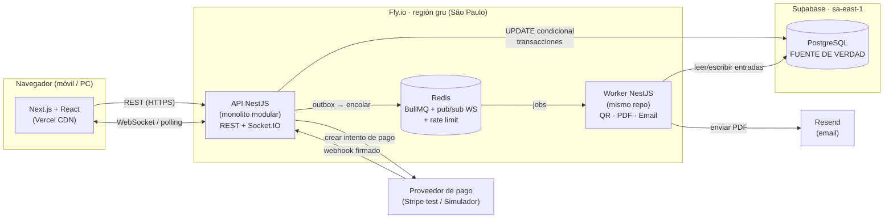

## 4. Decisiones clave y justificación

| Decisión | Por qué |
|---|---|
| **Monolito modular, no microservicios** | Somos 3 personas y tenemos 6 semanas. Los microservicios añaden red, despliegues y consistencia eventual entre servicios sin resolver nuestro problema real, que es la concurrencia sobre una tabla. Los módulos tienen fronteras claras para poder separarlos más adelante si hiciera falta. |
| **PostgreSQL decide quién gana el asiento** | `UPDATE asientos SET estado='RESERVADO' ... WHERE id=$1 AND estado='LIBRE'` es atómico: si 50 peticiones llegan a la vez, solo una afecta 1 fila y las otras 49 afectan 0. No hace falta un lock distribuido. |
| **Redis no decide nada crítico** | Redis se usa para la cola, el pub/sub entre instancias y el rate limiting. Si Redis se pierde, no se pierde ninguna venta. |
| **Reserva de 5 min con `expires_at`** | La reserva vence sola: la consulta trata como libre un asiento cuyo `expires_at` ya pasó, aunque el job de limpieza no haya corrido todavía. |
| **Webhook idempotente + outbox** | El proveedor de pagos puede enviar el mismo aviso dos veces. Una restricción única sobre el ID del evento impide emitir dos entradas. El outbox garantiza que, si se confirmó el pago, el email **siempre** termina enviándose. |
| **Worker separado** | Si el Worker se cae, la API sigue vendiendo. Los trabajos quedan en la cola y en el outbox y se procesan cuando vuelve. |
| **Pagos detrás de un adaptador** | Stripe no opera con comercios bolivianos. Para la demo usamos Stripe en modo test y un simulador propio. En producción iría un QR bancario interoperable sin cambiar el núcleo. |

## 5. Qué conceptos de Sistemas Distribuidos se demuestran

- **Control de concurrencia** (actualización condicional, aislamiento READ COMMITTED, restricciones únicas)
- **Idempotencia** y semántica **al-menos-una-vez** con deduplicación
- **Outbox transaccional** (problema de la doble escritura)
- **Tolerancia a fallos** (caída del Worker, reintentos con backoff, cola de fallidos)
- **Escalado horizontal** de WebSocket con adaptador Redis (pub/sub)
- **Consistencia eventual** del mapa en el cliente (versionado + resincronización)
- **Rate limiting** y **control de admisión** ante picos

## 6. Demostración en vivo (≈10 min)

1. **Carrera por un asiento:** un script lanza 50 peticiones simultáneas por el asiento A-10. Resultado: **1 × 201** y **49 × 409**. Los logs y las métricas lo muestran.
2. **Mapa en vivo:** dos navegadores. Al reservar en uno, el asiento cambia de color en el otro en menos de 1 s.
3. **Webhook duplicado:** el simulador envía dos veces el mismo pago y se emite **una** entrada.
4. **Caída del Worker:** se detiene el Worker, se hacen 3 compras y la cola crece. Al reiniciarlo, llegan los 3 emails.
5. **Expiración:** una reserva sin pagar se libera a los 5 min y el mapa se actualiza solo.
6. **Puerta:** se escanea el QR. La primera vez sale "VÁLIDA" y la segunda "YA USADA a las 21:04".

## 7. Alcance y límites honestos

- **Dentro:** comprador, organizador y validador; mapa en tiempo real; reserva; pago test; QR + PDF + email; validación.
- **Fuera:** búsqueda compleja, OAuth, recuperación de contraseña, facturación electrónica del SIN (queda un campo NIT opcional) y cobro real en Bolivia.
- **Límite de la demo:** la infraestructura es de nivel gratis o casi gratis. **No** soporta de verdad 15.000 usuarios simultáneos. En `docs/06` mostramos el cálculo de qué haría falta y dónde estarían los cuellos de botella.

## 8. Plan

Seis sprints semanales en slices verticales. La semana 2 ya incluye la prueba de 50 peticiones concurrentes con TDD. Detalle en `11-plan-6-semanas.md`.


# 01 — Visión y alcance

## 1. Visión

> Que cualquier persona en Bolivia pueda comprar desde el celular una entrada con asiento numerado para un concierto, una obra o un partido, **sin miedo a que le vendan su asiento a otra persona**, aunque miles intenten comprar al mismo tiempo.

## 2. Problema que resolvemos

Hoy, en muchos eventos de Bolivia:
- la venta es presencial o por WhatsApp/transferencia, con verificación manual del comprobante;
- los asientos se asignan "a mano" en planillas, lo que provoca **duplicados** y discusiones en la puerta;
- las páginas que intentan vender en línea **se caen** cuando se abre la venta de un evento popular.

Nuestro sistema ataca tres causas técnicas:
1. **Sobreventa** por concurrencia mal controlada.
2. **Caídas** porque todo ocurre en el camino síncrono (generar PDF, enviar email...).
3. **Falsificación** de entradas (capturas de pantalla, QR copiados).

## 3. Usuarios y roles

| Rol | Qué necesita | Ejemplo |
|---|---|---|
| **Comprador** | Ver eventos de su ciudad, elegir asiento, pagar y recibir la entrada | María, en Quillacollo, compra 2 asientos para un concierto en el Estadio Félix Capriles desde su celular con datos móviles |
| **Organizador/Admin** | Crear eventos, configurar el mapa de asientos y precios por zona, y ver las ventas | Una productora de Cochabamba carga un evento con 3 zonas: Platea, Preferencia y General numerada |
| **Validador** | Escanear el QR en la puerta y marcarlo como USADO | Un portero con un celular Android y conexión inestable en el ingreso al recinto |

## 4. Contexto Bolivia

| Aspecto | Decisión de diseño |
|---|---|
| **Moneda** | Bolivianos (BOB) guardados como **enteros en centavos**. Bs 150,50 se guarda como `15050`. |
| **Hora** | Se guarda en UTC y se muestra en `America/La_Paz` (UTC-4, sin horario de verano). Un concierto el sábado a las 21:00 en Cochabamba se guarda como `domingo 01:00 UTC`. |
| **Idioma** | Español de Bolivia en la interfaz, los emails y el PDF ("Bs", formato `1.234,50`). |
| **Teléfono** | Opcional, con formato `+591 7XXXXXXX`. |
| **Conectividad** | Usuarios con 4G de calidad variable. Frontend liviano, WebSocket con reconexión automática y polling de respaldo. |
| **Pagos** | Stripe no acepta comercios bolivianos (ver `13-pagos-en-bolivia.md`). La demo usa Stripe test + un simulador. En producción iría QR interoperable. |
| **Facturación SIN** | Fuera de alcance. La orden guarda `nit` y `razon_social` opcionales para integrarla después. |
| **Datos personales** | Mínimos (email, nombre y teléfono opcional). El QR no lleva datos personales y la contraseña se guarda con argon2id. |

## 5. Lanzamiento y expansión por fases

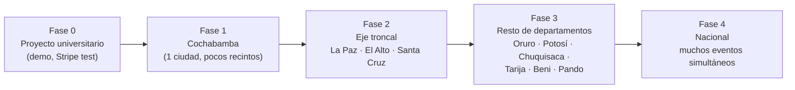

| Fase | Qué cambia en el negocio | Qué cambia en el sistema | ¿Rediseño? |
|---|---|---|---|
| 0 — Demo | Eventos de prueba | Todo en una región, infraestructura mínima | — |
| 1 — Cochabamba | Primeros organizadores reales | Pago real (QR bancario), dominio, monitoreo | No: se cambia el adaptador de pago |
| 2 — Eje troncal | Eventos simultáneos en 3 ciudades | Más instancias de la API, Postgres con más CPU, sala de espera virtual | No: el filtro por ciudad ya existe |
| 3 — Resto | Muchos recintos pequeños | Más datos de catálogo, quizá caché de listados | No |
| 4 — Nacional | Picos simultáneos | Réplicas de lectura y tal vez separar el módulo de Notificaciones o de Validación | Parcial: extraer módulos que ya tienen fronteras claras |

**Por qué no hace falta rediseñar:** desde el día 1 el modelo de datos es `departamento → ciudad → recinto → evento`, y toda consulta de catálogo filtra por ciudad. Agregar Tarija es **insertar filas**, no cambiar código.

## 6. Alcance

### Dentro
- Registro e inicio de sesión con email y contraseña (JWT), con roles.
- Listado de eventos **filtrado por ciudad**, más el detalle del evento.
- Mapa de asientos **en tiempo real**.
- Reserva temporal de **5 minutos** (máx. 6 asientos por orden).
- Pago con Stripe test o con el simulador, confirmado **por webhook**.
- Entrada con **QR firmado**, PDF y **email asíncrono**.
- Panel del organizador: crear evento, recinto y mapa (filas × columnas por zona) y precios.
- App web del validador: escanear QR y marcar USADA.
- Métricas y logs para la demo.

### Fuera (a propósito)
- Búsqueda de texto compleja, recomendaciones.
- OAuth (Google/Facebook) y recuperación de contraseña.
- Facturación electrónica del SIN (queda como mejora futura con campo NIT).
- Cobro real en Bolivia (queda documentado como adaptador futuro).
- Reventa, transferencia de entradas, reembolsos automáticos (los reembolsos se marcan para gestión manual).
- App nativa. El validador usa la web del celular.

## 7. Criterios de éxito del proyecto

1. Con 50 peticiones simultáneas por el mismo asiento, **siempre** gana exactamente una (probado en CI y en vivo).
2. Un webhook duplicado **nunca** produce dos entradas.
3. Con el Worker caído la venta sigue funcionando, y al volver se envían todos los emails pendientes.
4. El mapa se actualiza en otro navegador en **< 1 s (p95)** en condiciones normales.
5. El docente entiende la arquitectura con el `00-resumen-docente.md` y un diagrama.


# 02 — Requisitos

Notación: **RF** funcional · **RNF** no funcional · **RN** regla de negocio. Prioridad: **M** (must, imprescindible) · **S** (should, importante) · **C** (could, deseable).

## 1. Requisitos funcionales

### Autenticación y roles
| ID | Requisito | Prior. |
|---|---|---|
| RF-01 | Registrarse con email, contraseña (mín. 8 caracteres), nombre y teléfono opcional (+591). El rol por defecto es COMPRADOR. | M |
| RF-02 | Iniciar sesión y recibir un JWT con `sub`, `rol` y `exp`. | M |
| RF-03 | Un ADMIN puede asignar los roles ORGANIZADOR o VALIDADOR (los usuarios semilla se crean por script). | M |
| RF-04 | Los endpoints se protegen por rol (guard de NestJS). | M |

### Catálogo
| ID | Requisito | Prior. |
|---|---|---|
| RF-10 | Listar los eventos publicados, **filtrados por ciudad** (Cochabamba por defecto) y ordenados por fecha. | M |
| RF-11 | Ver el detalle del evento: recinto, ciudad, fecha en hora de Bolivia, zonas y precios en Bs. | M |
| RF-12 | Listar departamentos y ciudades con eventos activos. | S |

### Organizador
| ID | Requisito | Prior. |
|---|---|---|
| RF-20 | Crear y editar un recinto (nombre, dirección, ciudad). | M |
| RF-21 | Crear un evento en BORRADOR con título, recinto, fecha/hora local y fecha de apertura de venta. | M |
| RF-22 | Configurar zonas con su precio (centavos) y una grilla de filas × columnas, con asientos deshabilitables (pasillos). | M |
| RF-23 | Publicar el evento. Al publicar se generan las filas `asientos` y el mapa ya no se puede editar. | M |
| RF-24 | Ver el resumen de ventas: vendidos, reservados, libres y recaudación. | S |

### Compra
| ID | Requisito | Prior. |
|---|---|---|
| RF-30 | Ver el mapa con el estado de cada asiento (LIBRE / RESERVADO / VENDIDO / NO_DISPONIBLE). | M |
| RF-31 | Recibir **en vivo** los cambios de estado del mapa. | M |
| RF-32 | Reservar de 1 a 6 asientos de forma **atómica** (todos o ninguno). Se crea una orden PENDIENTE_PAGO que vence a los 5 min. | M |
| RF-33 | Ver un contador regresivo de la reserva. | M |
| RF-34 | Cancelar la reserva, que libera los asientos de inmediato. | S |
| RF-35 | Iniciar el pago con el proveedor configurado (Stripe test o simulador). | M |
| RF-36 | El pago se confirma **solo por webhook**, nunca porque el navegador "vuelva" de la página de pago. | M |
| RF-37 | Ingresar NIT y razón social opcionales para una futura factura. | C |
| RF-38 | Ver "Mis entradas" y descargar el PDF. | S |

### Entradas y notificaciones
| ID | Requisito | Prior. |
|---|---|---|
| RF-40 | Al confirmarse el pago se emite una entrada por asiento, con un QR firmado. | M |
| RF-41 | El Worker genera el PDF (en español, hora local) y lo envía por email de forma **asíncrona**. | M |
| RF-42 | Los envíos fallidos se reintentan con backoff. Tras N intentos el envío queda en "fallidos" y es visible. | M |

### Validación
| ID | Requisito | Prior. |
|---|---|---|
| RF-50 | El validador escanea el QR con la cámara del celular (web). | M |
| RF-51 | El sistema verifica la firma y marca la entrada USADA **una sola vez**. | M |
| RF-52 | Si ya estaba usada, muestra "YA USADA" con la hora local de uso. | M |
| RF-53 | El validador solo puede validar eventos asignados a él. | S |

## 2. Requisitos no funcionales (medibles)

| ID | Atributo | Requisito y métrica | Cómo se mide |
|---|---|---|---|
| RNF-01 | **Correctitud** | 0 sobreventas: con N peticiones concurrentes por el mismo asiento hay exactamente 1 éxito. | Test de integración en CI (N=50) + script de demo |
| RNF-02 | **Idempotencia** | Un webhook repetido K veces genera exactamente 1 orden PAGADA y 1 entrada por asiento. | Test de integración (K=5, en paralelo) |
| RNF-03 | **Latencia de reserva** | p95 < 300 ms en la API con carga de demo (50 req/s), medido en el servidor. | Métrica `http_request_duration` + script k6/autocannon |
| RNF-04 | **Tiempo real** | Cambio de asiento visible en otro cliente en p95 < 1 s. | Marca de tiempo en el evento WS vs. recepción |
| RNF-05 | **Tolerancia a fallos** | Con el Worker caído, el 100 % de las compras se completan. Al volver, todos los emails pendientes se envían en < 2 min. | Demo de caída |
| RNF-06 | **Reconexión** | Tras perder la red, el cliente reconecta solo (backoff hasta 10 s) y resincroniza el mapa. Si el WS falla 3 veces, pasa a polling cada 5 s. | Prueba manual con DevTools "Offline" + test e2e |
| RNF-07 | **Expiración** | Una reserva vencida no bloquea una nueva reserva **en ningún momento** (expiración perezosa). El job la limpia en ≤ 30 s. | Test con reloj controlado |
| RNF-08 | **Rendimiento móvil** | JS inicial de la página del mapa < 200 KB gzip. LCP < 2,5 s en 4G simulada. | Lighthouse (perfil "Slow 4G") |
| RNF-09 | **Seguridad** | Contraseñas con argon2id. JWT con expiración ≤ 60 min. Webhooks con firma verificada. QR firmado con Ed25519. | Revisión de código + tests |
| RNF-10 | **Rate limiting** | Reservas: máx. 10/min por usuario y 30/min por IP. Respuesta 429 con `Retry-After`. | Test de integración |
| RNF-11 | **Observabilidad** | Logs JSON con `requestId`. Métricas: reservas ok/conflicto, webhooks duplicados, tamaño de la cola, conexiones WS. | Endpoint `/metrics` + panel de demo |
| RNF-12 | **Disponibilidad (demo)** | La API responde en < 2 s tras inactividad (sin "cold start" de 1 min). | Máquinas siempre encendidas en Fly |
| RNF-13 | **Portabilidad** | Todo el sistema se levanta en local con Docker en < 5 min siguiendo el README. | Prueba de un integrante nuevo |
| RNF-14 | **Expansión** | Agregar un departamento o ciudad nueva no requiere cambios de código. | Script de semilla |

## 3. Reglas de negocio

| ID | Regla |
|---|---|
| RN-01 | Un asiento de un evento tiene **como máximo una entrada válida** (EMITIDA o USADA). |
| RN-02 | La reserva dura **5 minutos** desde su creación. Al iniciar el pago se extiende **una sola vez** 2 minutos, para pagos en curso. |
| RN-03 | Una orden reserva entre 1 y **6** asientos, todos del mismo evento. La reserva es **todo o nada**. |
| RN-04 | Un usuario puede tener **una sola** orden PENDIENTE_PAGO por evento. |
| RN-05 | Los montos son enteros en **centavos de BOB**. El total de la orden es la suma de los precios de las zonas **al momento de reservar** (precio congelado en `orden_items`). |
| RN-06 | Solo un webhook verificado puede pasar una orden a PAGADA. |
| RN-07 | Un pago que llega después de que se perdió el asiento (vencido y tomado por otro) deja la orden en **REEMBOLSO_REQUERIDO**, para gestión manual. Nunca se emite una entrada duplicada. |
| RN-08 | Una entrada pasa de EMITIDA a USADA **una sola vez**. No hay vuelta atrás desde el sistema. |
| RN-09 | No se venden asientos antes de `venta_inicio` ni después del inicio del evento. |
| RN-10 | Las fechas se muestran siempre en hora de Bolivia (`America/La_Paz`). |
| RN-11 | El QR no contiene nombre, email, CI ni teléfono, solo identificadores opacos y una firma. |

## 4. Fuera de alcance

| Elemento | Motivo | Mejora futura |
|---|---|---|
| Búsqueda compleja (texto libre, facetas) | No aporta al objetivo de concurrencia | Índice `pg_trgm` o un motor de búsqueda |
| OAuth | Complejidad sin valor didáctico aquí | Google Sign-In |
| Recuperación de contraseña | Requiere flujo de tokens por email, fuera del foco | Token de un solo uso con expiración |
| Facturación electrónica SIN | Integración regulatoria compleja (certificados, CUF, etc.) | Módulo de facturación que usa `nit`/`razon_social` |
| Cobro real en Bolivia | Requiere empresa con NIT y contrato con un banco o pasarela | Adaptador `QrBancario` (ver doc 13) |
| Reembolsos automáticos | Dependen del proveedor real | Job de reembolso con el adaptador |
| Validación offline en puerta | Conflictos de sincronización | Verificar la firma Ed25519 offline y sincronizar después (ver doc 05) |


# 03 — Arquitectura

## 1. Estilo arquitectónico

**Monolito modular + Worker asíncrono**, con comunicación híbrida (REST + WebSocket + cola).

- **Monolito modular:** un solo despliegue de la API (que puede tener *N* instancias idénticas), organizado en **módulos con fronteras explícitas**. Cada módulo es dueño de sus tablas y expone un servicio público. Los demás módulos no tocan sus tablas directamente.
- **Worker:** **otro proceso** compilado desde el mismo repositorio que consume la cola. Comparte código (entidades, adaptadores) pero **no** comparte el ciclo de vida: si se cae, la API no se entera.

### ¿Por qué esto y no otra cosa?

**Problema:** necesitamos un sistema que soporte picos de concurrencia, que sea tolerante a fallos en las tareas lentas y que 3 estudiantes puedan construir en 6 semanas.

**Opciones:**
1. Monolito "clásico" (todo en un proceso, sin módulos).
2. Monolito modular + Worker.
3. Microservicios (Catálogo, Reservas, Pagos, Entradas y Notificaciones separados).
4. Serverless (funciones sueltas en Vercel/Lambda).

**Elección:** opción 2.

**Por qué:**
- Frente a la 1: separar el Worker es lo que nos da **tolerancia a fallos real**. Generar un PDF o llamar a la API de email puede tardar segundos o fallar, y no debe ocurrir dentro de la petición del comprador. Los módulos evitan el "código espagueti" y nos permiten trabajar en paralelo.
- Frente a la 3: ver la sección 5.
- Frente a la 4: las funciones serverless **no mantienen conexiones WebSocket** de larga duración, abren una conexión a Postgres por invocación (lo que agota las conexiones en un pico) y complican los jobs en segundo plano.

## 2. Diagrama de componentes

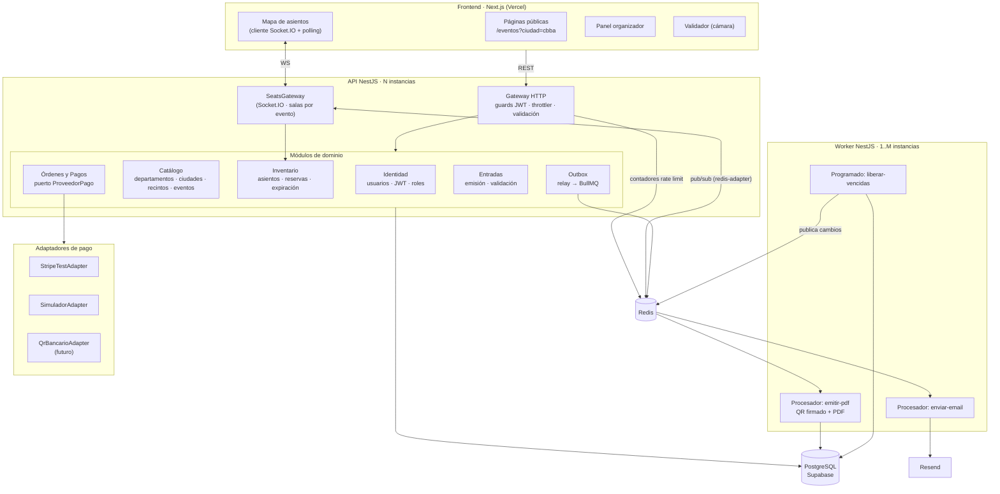

## 3. Justificación de cada componente

| Componente | Problema que resuelve | ¿Qué pasa si no está? | Alternativa descartada y por qué |
|---|---|---|---|
| **Next.js (Vercel)** | Páginas de catálogo rápidas en el celular (SSR/estático en CDN) y app React para el mapa | Una SPA pura tendría una carga inicial más pesada en 4G | SPA con Vite: válida, pero sin SSR el listado por ciudad tarda más en mostrarse en móviles lentos |
| **NestJS** | Estructura modular (módulos, DI, guards), WebSocket y BullMQ integrados, TypeScript en todo el stack | Con Express pelado, cada uno organizaría el código a su manera | Spring/Go: el equipo comparte TS con el frontend |
| **PostgreSQL** | **Fuente de verdad** con transacciones ACID, restricciones únicas y actualizaciones condicionales atómicas | Sin ACID no hay garantía de "un asiento, una entrada" | MongoDB: tiene operaciones atómicas por documento, pero las restricciones relacionales (FK, UNIQUE parciales) y las transacciones multitabla son más naturales en SQL |
| **Supabase** (solo Postgres) | Postgres administrado con backups, pooler y región São Paulo | Habría que operar Postgres nosotros | Supabase Auth/Realtime: **no se usan**. La auth y el tiempo real son parte de lo que queremos demostrar |
| **Redis** | 1) Transporte de la cola BullMQ · 2) pub/sub para el WebSocket con varias instancias · 3) contadores del rate limiting | Sin cola ni tolerancia a fallos, el WS solo funcionaría con 1 instancia | Usar Redis como lock de asientos: **descartado** (ver doc 04) |
| **BullMQ** | Cola con reintentos, backoff, cola de fallidos, jobs programados y deduplicación por `jobId` | Tendríamos que implementar reintentos a mano | RabbitMQ/Kafka: más potentes, pero un servicio más que operar **sin beneficio** a esta escala. Kafka **no aporta valor real** aquí |
| **Socket.IO** | Reconexión automática con backoff, salas, adaptador Redis y mensajes de confirmación (ack) | Con WS nativo habría que programar la reconexión y las salas a mano | SSE: válido para un solo sentido, pero el escalado multi-instancia es igual de complejo y Socket.IO trae más hecho |
| **Worker separado** | Aísla las tareas lentas o frágiles (PDF y email) | Una API de email lenta haría lento el checkout | Hacerlo en la misma API con `setImmediate`: si el proceso se reinicia, el trabajo **se pierde** |
| **Outbox (tabla)** | Garantiza que "pago confirmado" ⇒ "job encolado" aunque Redis falle en ese instante | Doble escritura: se confirma el pago en la BD, Redis falla y el email nunca sale | Encolar dentro de la transacción: imposible, Redis no participa en la transacción de Postgres |
| **Resend** | API de email simple, plan gratis de 3.000/mes (100/día), adjuntos | — | SendGrid: **retiró su plan gratis** en 2025 (ahora es una prueba de 60 días) |
| **Docker (local)** | El mismo Postgres y Redis para los 3 integrantes y para CI | "En mi máquina funciona" | Instalar Postgres a mano: versiones distintas |
| **GitHub Actions** | Los tests de concurrencia corren en cada PR contra un Postgres real | Una regresión de concurrencia llegaría a la demo | — |
| **Prisma** | Migraciones versionadas y tipos generados | — | TypeORM: también válido. Prisma es más sencillo de aprender. Las consultas críticas se escriben en **SQL explícito** con `$queryRaw` para que se vea qué hace la BD |

### Lo que **no** usamos y por qué (honestidad técnica)

| Tecnología | ¿Por qué no? |
|---|---|
| Microservicios | Ver sección 5 |
| Kubernetes | Fly.io ya da réplicas y despliegue. K8s sería semanas de configuración sin mejorar la nota de concurrencia |
| Kafka | Pensado para millones de eventos/s y retención larga. Nosotros tenemos decenas de jobs/s |
| GraphQL | Ver doc 05: nuestras consultas son pocas y fijas, y el tiempo real no encaja bien con suscripciones GraphQL a esta escala |
| Redlock / locks en Redis | Ver doc 04 |
| Service mesh, API gateway externo | Un solo servicio HTTP: no hay "malla" que gestionar |
| CQRS/Event Sourcing completo | Añade complejidad sin necesidad. Sí usamos una **idea** de CQRS: el mapa en vivo es una "vista de lectura" que se alimenta de eventos |

## 4. Módulos y sus fronteras

| Módulo | Tablas de las que es dueño | Expone | Depende de |
|---|---|---|---|
| Identidad | `usuarios` | `registrar`, `login`, guard JWT | — |
| Catálogo | `departamentos`, `ciudades`, `recintos`, `eventos`, `zonas` | `listarPorCiudad`, `publicar` | Identidad |
| Inventario | `asientos` | `reservar`, `liberar`, `marcarVendidos`, `snapshotMapa` | Catálogo |
| Órdenes y Pagos | `ordenes`, `orden_items`, `pagos`, `webhook_eventos` | `crearOrden`, `iniciarPago`, `procesarWebhook` | Inventario, Entradas |
| Entradas | `entradas`, `validaciones` | `emitir`, `validar` | — |
| Outbox | `outbox` | `registrar(evento)` (dentro de la transacción del llamador) | — |

**Regla:** si `Pagos` necesita marcar asientos como vendidos, llama a `InventarioService.marcarVendidos(tx, ordenId)` **pasando la transacción**. No hace un `UPDATE asientos` por su cuenta. Así, si algún día Inventario se separa, el punto de corte ya está definido.

## 5. Monolito modular vs. microservicios

### ¿Por qué NO microservicios en este proyecto?

1. **Nuestro problema difícil es transaccional, no organizacional.** Para "reservar asiento + crear orden" necesitamos **una transacción ACID**. Con Inventario y Órdenes en servicios distintos, cada uno con su base de datos, haría falta una **saga** con compensaciones: reservar en el servicio A, crear la orden en el B y, si B falla, liberar en A... Eso multiplica los casos de fallo que tenemos que probar.
2. **3 personas, 6 semanas.** Los microservicios rinden cuando hay **equipos independientes** que despliegan a ritmos distintos. Nosotros somos un solo equipo.
3. **Costo operativo.** Cada servicio pide su despliegue, su configuración, su monitoreo y su CI. En el free tier, eso significa más máquinas y más dinero.
4. **Latencia.** Cada salto de red añade milisegundos y un punto de fallo. En el camino de la reserva queremos **cero saltos** entre módulos.
5. **Escalado.** El monolito **sí escala horizontalmente**: corremos N copias idénticas detrás del balanceador. El cuello de botella es Postgres, y los microservicios no lo eliminan.

### ¿Cuándo SÍ tendrían sentido?

| Señal | Ejemplo en nuestra expansión nacional | Qué separaríamos |
|---|---|---|
| Un módulo tiene una **carga muy distinta** | En la Fase 4, la validación en puerta tiene picos en 50 recintos a las 20:00, mientras que la venta tiene picos al abrirse cada evento | **Validación** como servicio con su propia caché de entradas |
| Un módulo tiene **dependencias externas lentas o reguladas** | Integración con el SIN para facturar y con varios bancos para el QR | **Facturación** y **Pagos** como servicios con sus propios reintentos y credenciales aisladas |
| **Equipos distintos** | 3 equipos: catálogo/marketing, venta y operaciones en puerta | Un servicio por equipo |
| **Requisitos de seguridad distintos** | Cumplimiento con bancos (PCI, auditoría) | Pagos aislado en una red separada |
| **Tecnología distinta** | Generación masiva de PDF o imágenes | Servicio de renderizado |

**Conclusión:** empezamos con un monolito modular **diseñado para poder partirse** (módulos dueños de sus tablas, comunicación por servicios y eventos de outbox). Separar un módulo después es una decisión **reversible y gradual**: patrón *Strangler Fig* (ver doc 08).

## 6. Vista de procesos en ejecución

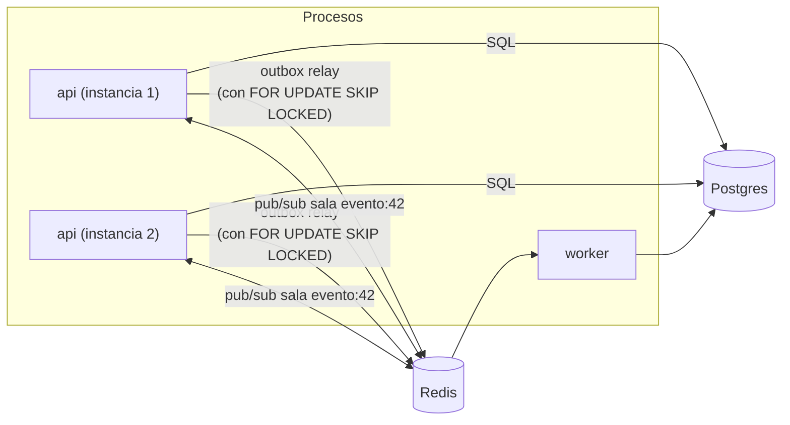

- **API:** atiende HTTP y WebSocket. Corre el **relay del outbox** cada ~500 ms. Varias instancias pueden correrlo a la vez gracias a `FOR UPDATE SKIP LOCKED`.
- **Worker:** procesa `emitir-pdf` y `enviar-email`, y cada 15 s el job repetible `liberar-vencidas`.
- **Por qué el relay está en la API y no en el Worker:** así, con el Worker caído, los jobs **se acumulan visiblemente en Redis** (se ve en la demo con Bull Board). Si además cae Redis, se acumulan en la tabla `outbox`. En ningún caso se pierden.


# 04 — Concurrencia y prevención de la doble compra

> **Invariante RN-01:** un asiento de un evento tiene **como máximo una** entrada válida.
> Todo este documento explica cómo lo garantizamos aunque haya miles de peticiones a la vez, varias instancias de la API, reintentos de red y webhooks duplicados.

## 1. Estados del asiento

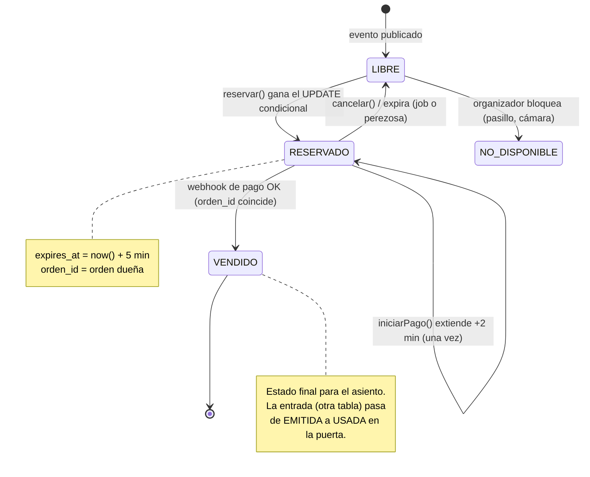

Y los estados de la **orden**:

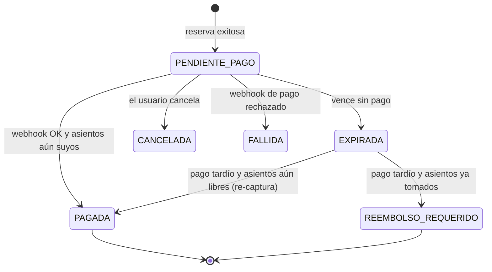

## 2. El problema, con un ejemplo

Ana (Cochabamba) y Beto (Sacaba) tocan el asiento **Platea F-12** en el mismo milisegundo. Las dos peticiones llegan a **instancias distintas** de la API.

Código ingenuo (**INCORRECTO**):

```text
1. SELECT estado FROM asientos WHERE id = 'F-12'   → 'LIBRE'  (Ana)
2. SELECT estado FROM asientos WHERE id = 'F-12'   → 'LIBRE'  (Beto)
3. UPDATE asientos SET estado='RESERVADO', orden=Ana
4. UPDATE asientos SET estado='RESERVADO', orden=Beto   ← pisa a Ana
```

Es una **condición de carrera** del tipo *check-then-act* (leer, decidir, escribir). Entre la lectura y la escritura, el mundo cambió.

## 3. Opciones para resolverlo

| Opción | Cómo funciona | Pros | Contras | ¿Elegida? |
|---|---|---|---|---|
| **A. UPDATE condicional atómico** ("bloqueo optimista" o *compare-and-set*) | `UPDATE ... WHERE estado='LIBRE'`: la condición y la escritura son **una sola operación** | Simple. Sin locks largos. El perdedor se entera de inmediato (0 filas) | Hay que manejar el "0 filas" | ✅ **Sí** |
| B. Bloqueo pesimista | `SELECT ... FOR UPDATE` y mantener la transacción abierta mientras el usuario decide o paga | Intuitivo | Las transacciones abiertas durante minutos agotan las conexiones. Los usuarios esperan en fila al de adelante. Riesgo de deadlocks | ❌ |
| C. Versión optimista clásica | Leer `version`, luego `UPDATE ... WHERE version = v` | Estándar en ORMs | Igual que A pero con un paso extra. Para un estado simple, A es más directo. (Igual guardamos `version` para el WebSocket) | Parcial |
| D. Lock distribuido en Redis (Redlock) | `SET lock:F-12 NX PX 5000` antes de tocar la BD | Rápido | **Dos fuentes de verdad.** Si el lock expira por una pausa (GC, red) dos procesos creen tenerlo. Si Redis pierde datos, se pierden locks. Igual hace falta la BD | ❌ |
| E. Cola única por evento (serializar) | Todas las reservas de un evento pasan por un solo consumidor | Imposible que haya carrera | Latencia alta, punto único de fallo, y el usuario no recibe la respuesta de inmediato | ❌ |
| F. Restricción única como única defensa | INSERT en `reservas(asiento_id)` UNIQUE y capturar el error | Muy robusto | Funciona, pero la expiración (borrar o reusar filas) se complica | Como **segunda red** |

### ¿Por qué no bloqueo pesimista? (B)

Problema: el comprador tarda de 30 s a 5 min en pagar. Si mantenemos `FOR UPDATE` durante ese tiempo:
- cada comprador ocupa **una conexión de Postgres**. El pooler gratuito de Supabase tiene decenas, no miles;
- el segundo usuario que toca F-12 **queda colgado esperando** en vez de recibir "ocupado" al instante;
- si el servidor se reinicia, Postgres libera el lock... pero el usuario pierde su reserva sin explicación.

El estado `RESERVADO` + `expires_at` es un **"lock lógico" persistido**: dura minutos, sobrevive a reinicios y **no ocupa conexiones**.

> Matiz técnico importante: el UPDATE condicional **sí** toma un lock de fila durante los milisegundos que dura su transacción. Lo que evitamos es mantener locks **mientras el usuario piensa**.

### ¿Por qué no lock distribuido en Redis? (D)

1. **Dos fuentes de verdad:** Redis dice "Ana tiene el lock" y Postgres dice "LIBRE". ¿A quién le creemos si discrepan?
2. **Los locks con TTL no son seguros ante pausas.** El proceso 1 toma el lock (TTL 5 s), sufre una pausa de 6 s (GC, red móvil, VM congelada), el lock expira, el proceso 2 lo toma y **ambos escriben**. Para evitarlo hacen falta *fencing tokens*, que tiene que verificar... la base de datos. Así que terminamos en la opción A igual.
3. **Redis no es durable por defecto.** Con un reinicio se pierden los locks.
4. **No aporta valor:** Postgres ya serializa los UPDATE sobre la misma fila. Añadir Redis solo agrega latencia y fallos posibles.

## 4. La solución elegida, paso a paso

### 4.1 Reservar (una sola sentencia, todo o nada)

```sql
-- Dentro de una transacción (READ COMMITTED, el nivel por defecto de Postgres)
WITH candidatos AS (
  SELECT id
  FROM asientos
  WHERE evento_id = $evento
    AND id = ANY($ids)                       -- máx. 6 asientos
    AND (
          estado = 'LIBRE'
       OR (estado = 'RESERVADO' AND expires_at < now())   -- expiración perezosa
    )
  ORDER BY id                                -- orden fijo ⇒ sin deadlocks
  FOR UPDATE SKIP LOCKED                     -- si otro lo está tocando, no esperar
)
UPDATE asientos a
SET estado     = 'RESERVADO',
    orden_id   = $orden,
    expires_at = now() + interval '5 minutes',
    version    = a.version + 1
FROM candidatos c
WHERE a.id = c.id
RETURNING a.id, a.version;
```

- Si `RETURNING` devuelve **tantas filas como asientos pedidos**: se crea la orden y sus ítems en la **misma transacción**, `COMMIT` y **201**.
- Si devuelve menos: **ROLLBACK** y **409 Conflict** con la lista de asientos no disponibles. Así se cumple el *todo o nada* (RN-03).

**Por qué cada parte:**
| Fragmento | Para qué |
|---|---|
| `estado='LIBRE' OR (... expires_at < now())` | **Expiración perezosa:** una reserva vencida se trata como libre **aunque el job aún no haya pasado**. La correctitud no depende del job |
| `ORDER BY id ... FOR UPDATE` | Dos órdenes que piden {F-12, F-13} y {F-13, F-12} toman los locks en el **mismo orden**, así que no puede haber *deadlock* |
| `SKIP LOCKED` | Si otra transacción está reservando F-12 en ese instante, no esperamos: F-12 queda fuera de los candidatos y respondemos 409 al instante |
| `version + 1` | El WebSocket envía la versión. El cliente descarta mensajes viejos que lleguen desordenados |

#### Versión mínima (un solo asiento), para entender la idea

```sql
UPDATE asientos
SET estado='RESERVADO', orden_id=$orden, expires_at=now()+interval '5 minutes'
WHERE id=$asiento AND (estado='LIBRE' OR (estado='RESERVADO' AND expires_at<now()))
RETURNING id;
```

¿Qué pasa con 2 transacciones simultáneas en READ COMMITTED?
1. T1 encuentra la fila LIBRE, la bloquea y la actualiza (todavía sin commit).
2. T2 encuentra la misma fila y **espera** el lock de T1 (milisegundos).
3. T1 hace COMMIT.
4. Postgres **re-evalúa el WHERE de T2** sobre la versión nueva de la fila: `estado='RESERVADO'` y `expires_at` está en el futuro, así que la condición es falsa y T2 actualiza **0 filas**.

Esta re-evaluación es la clave: el `WHERE` y el `SET` se comportan como **una sola operación atómica** sobre esa fila.

### 4.2 Segunda red de seguridad: restricciones en la BD

Aunque el código tuviera un bug, la base de datos impide el estado inválido:

```sql
-- Un asiento existe una vez por evento
UNIQUE (evento_id, fila, columna)

-- Una sola entrada válida por asiento (índice único parcial)
CREATE UNIQUE INDEX ux_entrada_valida_por_asiento
  ON entradas (asiento_id) WHERE estado IN ('EMITIDA','USADA');

-- Coherencia entre estado, orden y vencimiento
CHECK (
     (estado = 'RESERVADO'                 AND orden_id IS NOT NULL AND expires_at IS NOT NULL)
  OR (estado = 'VENDIDO'                   AND orden_id IS NOT NULL AND expires_at IS NULL)
  OR (estado IN ('LIBRE','NO_DISPONIBLE')  AND orden_id IS NULL     AND expires_at IS NULL)
)
```

> Nota sobre `SKIP LOCKED`: si la transacción que tenía bloqueada la fila termina en ROLLBACK, el segundo usuario recibió un 409 que en teoría no correspondía. Lo aceptamos: es raro, dura milisegundos y el usuario ve el asiento libre de nuevo en el mapa. A cambio, nadie se queda esperando un lock.

Así, la invariante RN-01 queda garantizada **por la base de datos**, no solo por nuestro código. Esto es *defensa en profundidad*.

### 4.3 Confirmar el pago (webhook)

```sql
-- Dentro de la transacción del webhook (ver doc 05 para la idempotencia)
UPDATE asientos
SET estado='VENDIDO', expires_at=NULL, version=version+1
WHERE orden_id = $orden AND estado = 'RESERVADO'
RETURNING id;
```
- Si se marcaron **todos** los asientos de la orden: orden PAGADA, `INSERT entradas` y `INSERT outbox` → COMMIT.
- **No** se exige `expires_at > now()` en este paso: si el pago llegó y nadie más tomó el asiento (sigue con nuestro `orden_id`), vendemos. Es la decisión más justa para el comprador.
- Si algún asiento ya tiene otro `orden_id` (venció y lo tomó otra persona): orden **REEMBOLSO_REQUERIDO**, se liberan los asientos que sí eran nuestros, outbox `REEMBOLSO_REQUERIDO` (email de disculpa). **Nunca** se emite una entrada duplicada.

## 5. Diagrama de secuencia: dos usuarios, un asiento

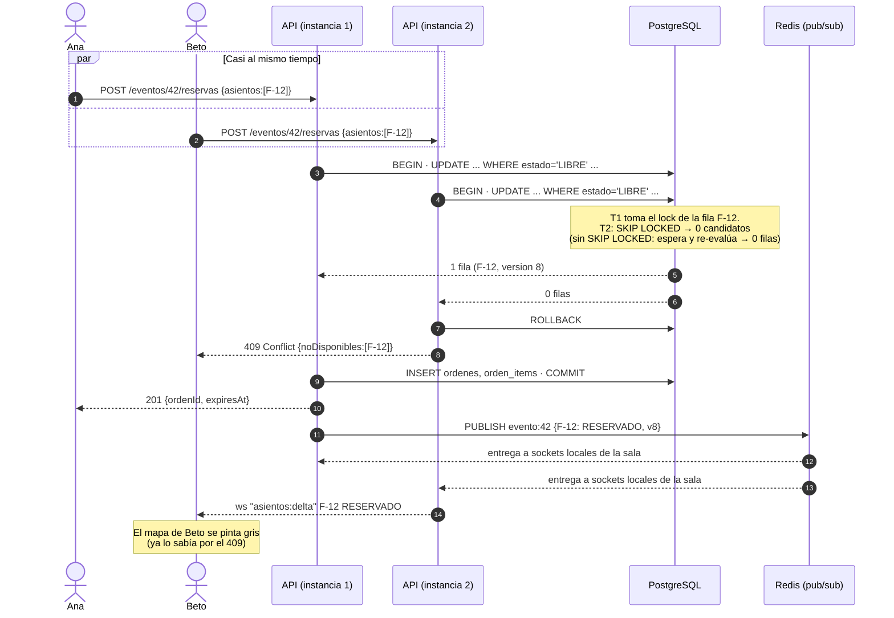

> Importante: **primero COMMIT, después PUBLISH.** Si publicáramos antes del commit y la transacción fallara, los clientes verían un estado que nunca existió. Si el PUBLISH falla después del commit, no pasa nada grave: el cliente se resincroniza (ver doc 05, §3).

## 6. Expiración de la reserva

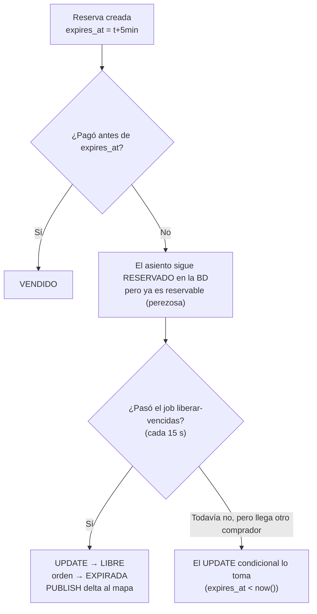

Job `liberar-vencidas` (en el Worker, repetible cada 15 s):

```sql
WITH vencidos AS (
  SELECT id FROM asientos
  WHERE estado='RESERVADO' AND expires_at < now()
  ORDER BY id
  LIMIT 500
  FOR UPDATE SKIP LOCKED
)
UPDATE asientos a SET estado='LIBRE', orden_id=NULL, expires_at=NULL, version=a.version+1
FROM vencidos v WHERE a.id=v.id
RETURNING a.id, a.evento_id, a.version;
-- luego: UPDATE ordenes SET estado='EXPIRADA' WHERE estado='PENDIENTE_PAGO' AND expires_at < now()
-- luego: PUBLISH deltas por evento
```

- **`SKIP LOCKED` + `LIMIT`**: si hay 2 Workers no procesan la misma fila, y un lote grande no bloquea la tabla.
- **Si el Worker está caído:** los asientos vencidos se ven como RESERVADO en el mapa (dato visual algo desactualizado), pero **se pueden reservar** igual, gracias a la expiración perezosa. Además, el endpoint del mapa calcula `estado_efectivo` con la misma regla, así que **incluso el mapa se ve bien**:
  ```sql
  CASE WHEN estado='RESERVADO' AND expires_at < now() THEN 'LIBRE' ELSE estado END
  ```
- **Relojes:** todas las comparaciones usan `now()` **de Postgres**, nunca la hora del servidor de la API. Así se evitan errores por relojes desincronizados entre máquinas (*clock skew*). El contador del navegador es solo visual y se calcula a partir del `expiresAt` que envía el servidor.

## 7. ¿Qué pasa si falla cada paso?

| # | Falla | Qué ve el usuario | Estado del sistema | Por qué es seguro |
|---|---|---|---|---|
| 1 | La petición de reserva se pierde en la red móvil **antes** de llegar | Spinner, luego error. Reintenta | Nada cambió | — |
| 2 | La reserva se hizo, pero la **respuesta** se perdió | Error. Al reintentar recibe 409... ¡por su propio asiento! | Orden PENDIENTE_PAGO del mismo usuario | La petición lleva `Idempotency-Key` (UUID generado por el cliente). Un reintento con la misma clave **devuelve la orden existente** (201) en vez de 409. Además RN-04 (una orden pendiente por evento) permite mostrarle "Ya tienes una reserva" |
| 3 | La API se cae **durante** la transacción de reserva | Error | Postgres hace ROLLBACK automático | Atomicidad |
| 4 | La API se cae **después** del COMMIT y antes de PUBLISH | Su reserva existe y los demás no la ven en vivo | El mapa de los demás queda desactualizado hasta el próximo delta o resync | Si otro intenta reservar ese asiento, recibe 409. La BD decide, no el mapa |
| 5 | Redis cae | La reserva funciona. El mapa en vivo se congela y los clientes pasan a polling REST | Rate limiting en modo degradado (memoria local) | Redis no participa en la decisión |
| 6 | El usuario cierra la pestaña sin pagar | — | La reserva vence a los 5 min | Expiración perezosa + job |
| 7 | El usuario paga pero el **webhook** tarda 10 min | "Procesando pago..." | Puede vencer la reserva | Si el asiento sigue con su `orden_id` se vende. Si lo tomó otra persona: REEMBOLSO_REQUERIDO |
| 8 | Llega el **webhook duplicado** | — | — | `UNIQUE(proveedor, evento_externo_id)` (doc 05) |
| 9 | El Worker cae al emitir el PDF | La entrada aparece en "Mis entradas". El email llega más tarde | Job en Redis (o fila en outbox) | Reintento al volver |
| 10 | El reloj de una instancia de la API está adelantado 2 min | Nada | Nada | Solo usamos `now()` de Postgres |
| 11 | Un bug en el código intenta emitir 2 entradas del mismo asiento | Error 500 en un caso límite | El INSERT falla | Índice único parcial `ux_entrada_valida_por_asiento` |
| 12 | Dos validadores escanean la misma entrada a la vez | Uno ve VÁLIDA y el otro YA USADA | Una fila USADA | Mismo patrón: `UPDATE entradas SET estado='USADA' WHERE id=$1 AND estado='EMITIDA'` |

## 8. Qué probamos con TDD (adelanto del doc 10)

1. 50 reservas concurrentes del mismo asiento ⇒ exactamente 1 éxito.
2. 2 órdenes con asientos solapados {1,2,3} y {3,4,5} ⇒ una gana todo y la otra recibe 409, sin reservas parciales.
3. 2 órdenes con asientos en orden inverso ⇒ ningún deadlock (timeout del test: 5 s).
4. Una reserva vencida (reloj de BD manipulado con `expires_at` en el pasado) ⇒ otra orden puede reservar sin que corra el job.
5. El job de expiración con 2 instancias en paralelo ⇒ cada asiento se libera una vez.
6. Validación doble concurrente ⇒ una VÁLIDA y una YA_USADA.


# 05 — Comunicación, idempotencia y pagos

## 1. Tres canales, cada uno para lo que sirve

| Canal | Se usa para | Por qué este canal |
|---|---|---|
| **REST (HTTPS + JSON)** | Login, catálogo, reservar, pagar, mis entradas, validar QR, panel del organizador | Petición-respuesta simple, cacheable (catálogo), fácil de probar con curl, y los códigos HTTP expresan bien el resultado (201, 409, 429) |
| **WebSocket (Socket.IO)** | **Solo** el estado de los asientos en vivo (servidor → cliente) | Empuja cambios sin que el cliente pregunte. Con polling a 1 s, 5.000 usuarios harían 5.000 req/s solo para "¿cambió algo?" |
| **Cola (BullMQ sobre Redis)** | Generar QR + PDF, enviar el email y el job de expiración | Trabajo lento o frágil que **no** debe bloquear al comprador y que necesita reintentos |

**Regla de oro:** el WebSocket **solo informa**, nunca decide. Para reservar siempre se usa `POST /reservas` (REST). Así las acciones importantes tienen respuesta, código de error e `Idempotency-Key`, y el WS se puede perder sin consecuencias.

### ¿Por qué no GraphQL?

- **Problema:** ¿necesitamos un lenguaje de consulta flexible?
- **Opciones:** REST, GraphQL, gRPC.
- **Elección:** REST.
- **Por qué:**
  - Tenemos **pocos endpoints fijos** (≈20). GraphQL rinde cuando hay muchos clientes con necesidades de datos distintas, y nosotros tenemos uno.
  - El **caché HTTP** del catálogo (CDN, `Cache-Control`) es trivial en REST y difícil en GraphQL (todo es `POST /graphql`).
  - El **rate limiting por endpoint** (p. ej. `/reservas`) es directo en REST. En GraphQL habría que analizar la consulta.
  - Las **suscripciones GraphQL** usan WebSocket por debajo. No resuelven el escalado: tendríamos el mismo problema con una capa más encima.
  - Curva de aprendizaje: 6 semanas.
  - gRPC no corre nativamente en el navegador y no tenemos comunicación entre servicios.

## 2. Contrato REST (resumen)

| Método y ruta | Rol | Respuestas clave |
|---|---|---|
| `POST /auth/registro` · `POST /auth/login` | público | 201 / 200 `{token}` · 401 |
| `GET /ciudades` | público | 200 |
| `GET /eventos?ciudad=cochabamba&desde=...` | público | 200 (cache 30 s) |
| `GET /eventos/:id` | público | 200 |
| `GET /eventos/:id/asientos` | público | 200 `{version, asientos:[...]}` (snapshot) |
| `GET /eventos/:id/asientos?desdeVersion=812` | público | 200 `{version, cambios:[...]}` (delta para polling) |
| `POST /eventos/:id/reservas` + `Idempotency-Key` | comprador | 201 `{ordenId, expiresAt, totalCentavos}` · **409** `{noDisponibles}` · 429 |
| `DELETE /ordenes/:id` | comprador (dueño) | 204 |
| `POST /ordenes/:id/pago` | comprador (dueño) | 200 `{proveedor, redirectUrl \| clientSecret}` |
| `POST /webhooks/pagos/:proveedor` | proveedor (firma) | **200** siempre que la firma sea válida (incluso si es duplicado) · 400 si la firma es inválida |
| `GET /mis-entradas` · `GET /entradas/:id/pdf` | comprador | 200 |
| `POST /validaciones` `{qr}` | validador | 200 `{resultado: VALIDA \| YA_USADA \| INVALIDA \| OTRO_EVENTO, usadaEn?}` |
| `POST /admin/eventos` ... | organizador | 201 |

**Formato de dinero:** siempre `{"totalCentavos": 30000, "moneda": "BOB"}`. El frontend formatea `Bs 300,00` con `Intl.NumberFormat('es-BO', {style:'currency', currency:'BOB'})`.
**Formato de fecha:** ISO 8601 en UTC (`2026-11-22T01:00:00Z`). El frontend lo muestra en `America/La_Paz` ("sáb. 21 nov., 21:00").

## 3. WebSocket: protocolo del mapa en vivo

```text
cliente → servidor   "evento:unirse"   {eventoId: 42}
servidor → cliente   "asientos:snapshot" {version: 812, asientos: <compacto>}
servidor → cliente   "asientos:delta"  {desde: 812, hasta: 815, cambios:[{id, estado, v}]}
```

### Versionado y resincronización

- Cada evento tiene un contador `mapa_version`, que se incrementa con cada cambio de asiento.
- El cliente guarda `versionLocal`. Si llega un delta con `desde > versionLocal`, **le falta algo** (se perdió un mensaje), así que pide `GET /asientos?desdeVersion=versionLocal`, o el snapshot completo si la diferencia es grande.
- Así toleramos mensajes **perdidos, duplicados o desordenados** (*consistencia eventual* del cliente).

### Reconexión y respaldo con polling (redes móviles)

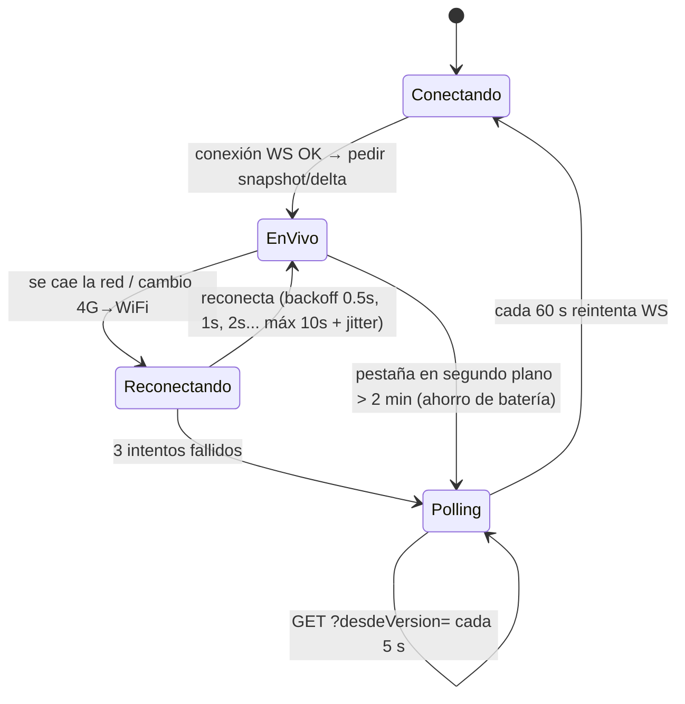

- Socket.IO trae reconexión automática con backoff exponencial y *jitter*. El *jitter* (aleatoriedad) evita que 5.000 celulares reconecten **en el mismo milisegundo** tras un microcorte (efecto *thundering herd*).
- Transporte: `transports: ['websocket']`. **No** usamos el long-polling de Socket.IO porque, con varias instancias, exige *sticky sessions*. El respaldo es **nuestro polling REST**, que no tiene estado y funciona con cualquier instancia.
- Tras **cada** reconexión, el cliente pide el delta desde su versión: durante el corte pudo perderse cambios.

### Formato compacto del snapshot

15.000 asientos × `{"id":"...","fila":"F","col":12,"estado":"LIBRE"}` ≈ 900 KB. Inviable en 4G.
**Solución:** la geometría (filas, columnas, zonas) es **estática**, se descarga una vez y se cachea en la CDN. El estado se envía como una cadena con **1 carácter por asiento** en orden fijo (`L`, `R`, `V`, `X`): 15.000 bytes ≈ **3–4 KB con gzip**.

## 4. Flujo completo del pago y el webhook

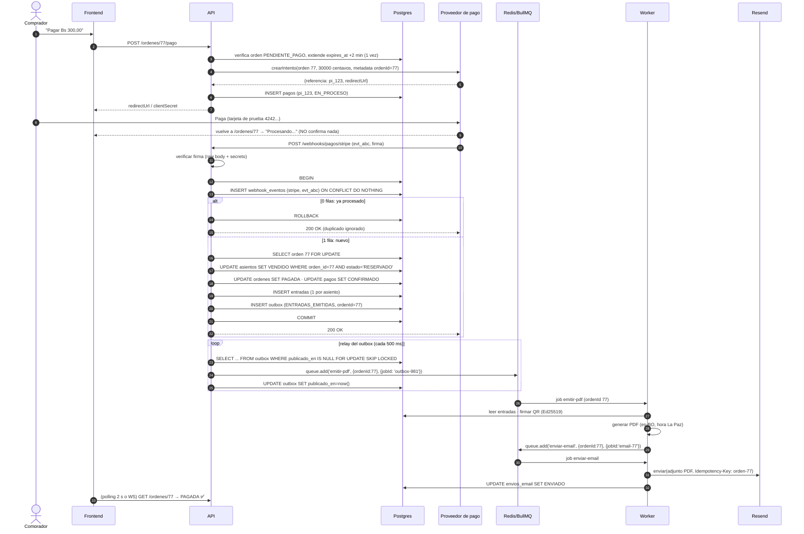

### Detalles que importan

1. **El navegador nunca confirma un pago.** La URL de retorno puede ser falsificada, o el usuario puede cerrar la pestaña. **Solo el webhook firmado** confirma.
2. **Raw body:** la firma de Stripe se calcula sobre el cuerpo **exacto** en bytes. NestJS debe habilitar `rawBody: true` para esa ruta. Si el JSON se parsea y se vuelve a serializar, la firma no coincide.
3. **Responder 200 al duplicado.** Si respondiéramos 4xx/5xx, el proveedor **seguiría reintentando**.
4. **Responder rápido.** Stripe espera una respuesta en pocos segundos. Por eso la transacción del webhook solo hace escrituras en la BD, y el PDF y el email van por la cola.
5. **Verificar el monto.** Si `evento.monto != orden.totalCentavos` o la moneda no coincide: no se emiten entradas, la orden pasa a `REVISION_MANUAL` y se genera una alerta.
6. **Orden de llegada:** un `payment_failed` puede llegar **después** de un `succeeded` (reintentos del proveedor). Regla: una orden PAGADA **no retrocede** por un evento posterior de fallo.

## 5. Idempotencia en cada capa

**Idempotente** = repetir la operación produce el mismo efecto que hacerla una vez.

| Capa | Riesgo de duplicado | Mecanismo |
|---|---|---|
| Cliente → `POST /reservas` | El usuario toca dos veces, o la red reintenta | Header `Idempotency-Key` (UUID v4 del cliente) guardado con la orden: `UNIQUE(usuario_id, idempotency_key)`. Repetir devuelve la misma respuesta |
| Proveedor → webhook | El proveedor reintenta, o el simulador envía a propósito 2–5 veces | `webhook_eventos UNIQUE(proveedor, evento_externo_id)` dentro de la **misma transacción** que emite las entradas |
| Mismo pago con eventos distintos | Dos eventos diferentes (`checkout.session.completed` y `payment_intent.succeeded`) por el mismo cobro | `pagos UNIQUE(proveedor, referencia_externa)` + la orden solo pasa de PENDIENTE a PAGADA una vez (`UPDATE ... WHERE estado IN ('PENDIENTE_PAGO','EXPIRADA')`) |
| Emisión de entradas | Bug o carrera | Índice único parcial por asiento (doc 04) |
| Outbox → cola | El relay publica, cae antes de marcar `publicado_en` y vuelve a publicar | `jobId = 'outbox-<id>'`: BullMQ **ignora** un job con un `jobId` que ya existe |
| Worker → email | El job envía el email y el Worker cae antes de marcarlo como completado, así que BullMQ lo reintenta | Tabla `envios_email UNIQUE(orden_id, tipo)` con estado + `Idempotency-Key` hacia Resend (si el proveedor lo soporta: verificar en su documentación actual). **Sin garantía absoluta:** un email duplicado es un riesgo aceptado y documentado (no hace daño, la entrada es la misma) |
| Validador → `POST /validaciones` | Doble escaneo | `UPDATE ... WHERE estado='EMITIDA'` (doc 04) |

### Al-menos-una-vez + idempotencia = "efectivamente una vez"

Las colas y los webhooks garantizan **al menos una** entrega. "Exactamente una vez" en la red no existe en general. Lo que sí podemos lograr es que **el efecto** ocurra una vez: el mensaje llega 1..N veces, y el consumidor idempotente lo aplica una.

## 6. Outbox transaccional

**Problema (doble escritura):** al confirmar el pago hay que (a) guardar en Postgres y (b) encolar en Redis. No existe una transacción que abarque ambos.
- Si encolamos antes del COMMIT y el COMMIT falla, se envía un email de una entrada que no existe.
- Si encolamos después del COMMIT y la API cae justo entre los dos pasos, se pagó y **nunca** se envía el email.

**Opciones:** 1) aceptar el riesgo · 2) outbox · 3) CDC (Debezium leyendo el WAL) · 4) que el Worker escanee tablas buscando trabajo pendiente.

**Elección:** **outbox** (con polling).
**Por qué:** dentro de la misma transacción se inserta una fila `outbox`. Si hay COMMIT, la intención de encolar es **durable**, y un *relay* la publica después (al menos una vez). CDC sería más eficiente pero exige infraestructura que **no aporta valor** a esta escala.

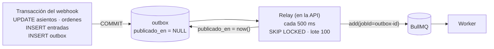

Si Redis está caído, el relay falla, la fila sigue con `publicado_en = NULL` y se reintenta en el próximo ciclo. **La venta no se detiene.**

## 7. Reintentos, backoff y cola de fallidos

| Job | Intentos | Backoff | Al agotarse |
|---|---|---|---|
| `emitir-pdf` | 5 | exponencial 5 s, 10 s, 20 s, 40 s, 80 s | Queda en *failed*. Alerta en logs. Botón "reintentar" en Bull Board |
| `enviar-email` | 8 | exponencial 30 s ... (≈ 2 h en total) | *failed* + `envios_email.estado = FALLIDO`. Visible para el organizador |
| `liberar-vencidas` | repetible cada 15 s | — | Si falla una vez, la siguiente corrida lo cubre (y la expiración perezosa protege igual) |

**Errores transitorios vs. permanentes:** un `503` de Resend o un timeout se **reintentan**. Un email inválido (`422`) **no se reintenta**: se marca FALLIDO de inmediato. Reintentar un error permanente solo gasta la cuota (100 emails/día en el plan gratis).

## 8. Pagos detrás de un puerto (Adapter + Strategy)

**Problema:** Stripe no sirve en producción en Bolivia, y el proveedor real (QR bancario) todavía no existe para nosotros. No queremos reescribir Órdenes cuando cambie el proveedor.

**Elección:** un **puerto** (interfaz) en el dominio y un **adaptador** por proveedor. Qué adaptador se usa lo decide la configuración (`PAYMENT_PROVIDER=stripe|simulador|qr`): eso es el patrón Strategy.

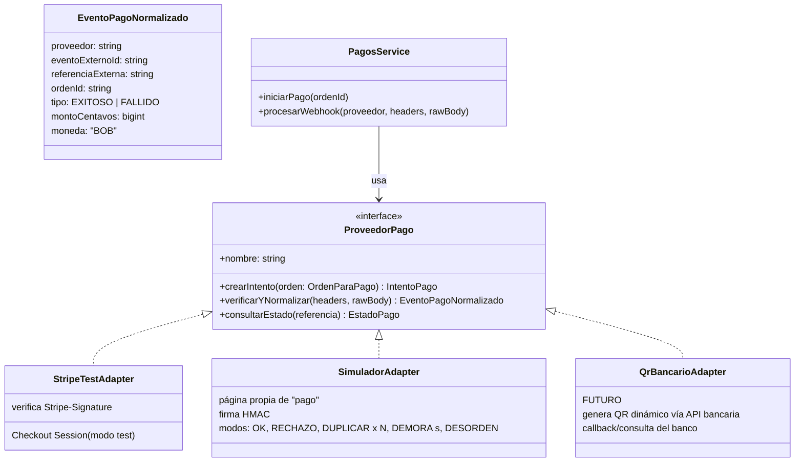

- `PagosService.procesarWebhook` **no sabe** de Stripe: recibe un `EventoPagoNormalizado` y aplica las reglas (idempotencia, asientos, entradas, outbox). **Las reglas se prueban una vez** y valen para todos los proveedores.
- **SimuladorAdapter** es clave para la demo y los tests: permite **inyectar fallos** de forma determinista:
  - `?modo=duplicar&veces=5`: envía el mismo webhook 5 veces en paralelo;
  - `?modo=demora&s=400`: el webhook llega después de que venció la reserva;
  - `?modo=desorden`: llega `FALLIDO` después de `EXITOSO`;
  - `?modo=rechazo`: pago rechazado.
- **QrBancarioAdapter (futuro):** genera un QR **dinámico** con monto y referencia. La confirmación llega por *callback* del banco o por consulta periódica (`consultarEstado`). El job de reconciliación usa `consultarEstado` para las órdenes "EN_PROCESO" de más de 10 min, por si se perdió un callback. Detalle en `13-pagos-en-bolivia.md`.

## 9. Validación en puerta (y por qué el QR usa Ed25519)

- Contenido del QR: `TKT1.<base64url(payload)>.<base64url(firma)>`, con payload `{"t":"<uuid entrada>","e":42,"i":1732237200}`. **Sin datos personales.**
- Firma **Ed25519** (asimétrica): solo el Worker tiene la **clave privada**. La API (y en el futuro la app del validador) solo necesitan la **pública**.
  - Ventaja frente a HMAC: un validador con la clave pública podría verificar la autenticidad **sin conexión**, algo útil en recintos con mala señal. Con HMAC, quien verifica también podría **firmar** (falsificar).
- La firma demuestra que **la entrada es auténtica**. La marca USADA (que no se use dos veces) exige consultar la BD **en línea**. El modo offline (lista local + sincronización posterior + resolución de conflictos) queda como mejora futura.


# 06 — Carga y escalabilidad

> Las cifras de este documento son **estimaciones de orden de magnitud** ("cálculos de servilleta") para razonar sobre el diseño. No son mediciones. Las mediciones reales de la demo se registran en `10-pruebas-y-demo.md`.

## 1. Escenario: concierto en el Estadio Félix Capriles (Cochabamba)

| Supuesto | Valor |
|---|---|
| Asientos numerados en venta | 15.000 (peor caso) |
| Personas esperando a la hora de apertura | ~30.000 (2 por asiento) |
| Llegada | El 50 % en el **primer minuto** y el resto en los 10 siguientes |
| Asientos por orden | 2,5 en promedio (máx. 6) |
| Conexión | 80 % móvil (4G con latencia de 60–300 ms y microcortes) |
| Tiempo para agotar las entradas | ~15–30 min |

### Cálculo del pico

| Operación | Cálculo | Pico estimado |
|---|---|---|
| Cargar página del evento + geometría del mapa | 15.000 usuarios en 60 s | ~250 req/s (**la CDN lo absorbe**: es estático) |
| Snapshot del estado del mapa | 15.000 en 60 s, ~4 KB cada uno | ~250 req/s · ~1 MB/s |
| Conexiones WebSocket simultáneas | 30.000 × 70 % con la pestaña abierta | **~20.000 conexiones** |
| Intentos de reserva | Cada usuario intenta 2–4 veces (muchos 409) en los primeros 2 min | **~500–1.000 req/s** de pico |
| Reservas exitosas | 15.000 / 2,5 = 6.000 órdenes en ~15 min | ~7 órdenes/s promedio, ~50/s en el pico |
| Cambios de asiento | 15.000 reservas + liberaciones + ventas | ~20–60 cambios/s |
| Webhooks | = órdenes pagadas | ~5–20/s |
| Emails y PDF | = órdenes pagadas | ~5–20 jobs/s (**se encolan**; pueden tardar minutos) |

### Lo que revela el cálculo
- **El problema no son las escrituras de reserva** (~1.000/s): Postgres resuelve UPDATEs de una fila por clave primaria a miles por segundo **con hardware dedicado**.
- **El problema grande es la difusión (*fan-out*) del WebSocket:** 40 cambios/s × 20.000 clientes = **800.000 mensajes/s** si se envía cada cambio a cada cliente. Inviable.
- **El segundo problema es la "manada"** que golpea en el mismo segundo y los reintentos agresivos.

## 2. Cuellos de botella y mitigaciones

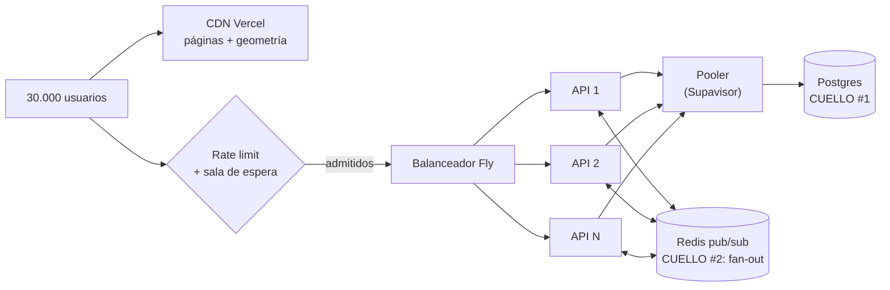

| # | Cuello de botella | Síntoma | Mitigación en el diseño |
|---|---|---|---|
| 1 | **Conexiones a Postgres** | `too many connections`, latencia alta | Pool pequeño **por instancia** (p. ej. 10), el pooler de Supabase en modo transacción y transacciones **cortas** (sin esperar al usuario dentro de una) |
| 2 | **Contención de filas "calientes"** | Los mejores asientos (fila A, centro) reciben cientos de intentos | `SKIP LOCKED`: el perdedor **no espera**, recibe 409 en ms. El cliente sugiere "asientos libres cercanos" |
| 3 | **Fan-out del WebSocket** | CPU de la API al 100 % y mensajes atrasados | **Agrupación (*coalescing*)**: los cambios de cada evento se juntan cada 250 ms en **un** delta. Envío del cambio solo a la **sala de la zona** que el usuario está mirando (`evento:42:zona:platea`). Formato compacto |
| 4 | **Snapshot del mapa** | Muchas lecturas iguales a la vez | Caché del snapshot en memoria de cada instancia con **TTL de 1 s** + `version`. 1.000 lecturas/s se convierten en 1 consulta/s por instancia (*microcaching*) |
| 5 | **Reintentos agresivos del cliente** | Tormenta de 409 y 429 | Backoff + *jitter* en el cliente. Botón deshabilitado mientras hay una petición en curso. `Retry-After` en 429 |
| 6 | **Email / PDF** | Proveedor lento o con cuota diaria | Cola: la venta **no espera**. El usuario ve la entrada en "Mis entradas" aunque el email tarde |
| 7 | **Webhooks en ráfaga** | Muchos POST del proveedor | Transacción corta, respuesta rápida y trabajo pesado en la cola |

## 3. Escalado horizontal

### API (sin estado)
- Las instancias de la API **no guardan estado en memoria** que importe: el JWT viaja en cada petición, la verdad está en Postgres y el pub/sub en Redis.
- Se pueden añadir instancias con `fly scale count 3`. El balanceador reparte.
- Lo único "con estado" es la conexión WebSocket, y se resuelve con el adaptador Redis (abajo).

### Worker
- Varias instancias del Worker consumen la misma cola. BullMQ garantiza que **cada job lo toma un solo Worker** a la vez (con un lock interno y renovación).
- La concurrencia por Worker se configura (`concurrency: 5` para PDF).

### Postgres
- **Vertical primero** (más CPU/RAM): es lo más simple y suficiente para la Fase 1–2.
- **Réplicas de lectura** para el catálogo y "mis entradas" en la Fase 4. **Nunca** para reservar: una réplica con retraso daría estados viejos. Las reservas **siempre** van al primario.
- **Particionado** por evento (o por departamento) solo si llegáramos a tablas de cientos de millones de filas. **No hace falta** en ninguna fase prevista.

## 4. WebSocket con varias instancias

**Problema:** Ana está conectada a la API 1 y Beto a la API 2. Si la reserva de Ana ocurre en la API 1, ¿cómo se entera Beto?

**Opciones:**
1. *Sticky sessions* + que cada instancia consulte la BD periódicamente: retraso y carga.
2. **Adaptador Redis de Socket.IO** (pub/sub): cada instancia publica en Redis y todas reciben.
3. Un servicio de tiempo real externo (Pusher, Ably, Supabase Realtime): rompe el objetivo didáctico y tiene límites de free tier.

**Elección:** 2, `@socket.io/redis-adapter`.

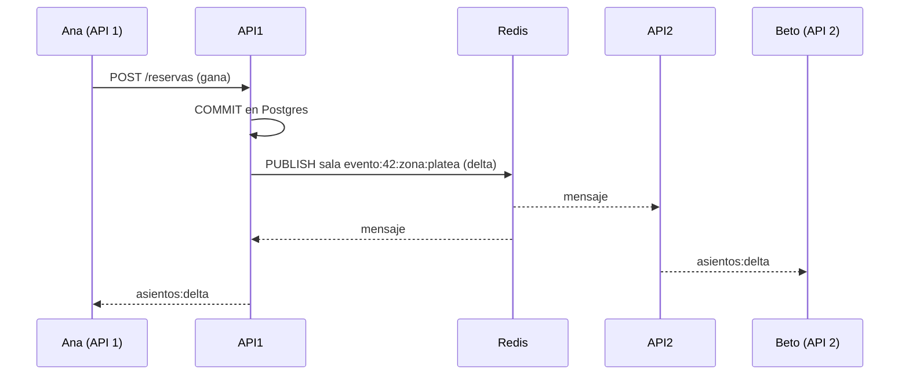

- **Si Redis cae:** cada instancia solo informa a sus propios sockets, y los clientes notan "silencio" y pasan a polling (doc 05). **Nada se vende mal.**
- **Límite por instancia:** una instancia Node con 256–512 MB sostiene del orden de miles de conexiones WS inactivas. Para 20.000 harían falta varias instancias más grandes. Esto **no** es alcanzable en el free tier y se documenta como proyección.

## 5. Rate limiting y control de admisión

### Rate limiting (implementado)
- `@nestjs/throttler` con almacenamiento en **Redis** (compartido entre instancias).

| Endpoint | Límite | Clave |
|---|---|---|
| `POST /auth/login` | 5/min | IP + email (contra fuerza bruta) |
| `POST /eventos/:id/reservas` | 10/min | usuario. Además 30/min por IP (protege contra bots con muchas cuentas) |
| `GET /eventos/:id/asientos` | 60/min | IP |
| `POST /validaciones` | 120/min | validador |

- Algoritmo: **ventana deslizante** o **token bucket**. Respuesta: `429` + `Retry-After`.
- **Si Redis cae:** el throttler sigue con un contador **en memoria por instancia** (degradado, menos preciso). Se prefiere esto a rechazar todo.
- **IP compartida (CGNAT):** en redes móviles bolivianas muchos usuarios salen por la **misma IP pública** del operador. Por eso el límite por IP es generoso y el límite principal es **por usuario**.

### Sala de espera virtual (diseño para producción, opcional en la demo)
En lugar de dejar entrar a 30.000 personas a la vez, se las **admite a ritmo controlado** (p. ej. 500 cada 10 s):
1. A la hora de apertura, el usuario recibe un **turno** (`ZADD sala:42 <timestamp> <usuario>` en Redis).
2. Un proceso admite a los primeros N y les da un **token de admisión** firmado con validez de 10 min.
3. `POST /reservas` exige ese token.

Aquí Redis **sí** tiene sentido: el orden de la fila es una optimización de experiencia, no una garantía de correctitud. Si se pierde, se reconstruye y nadie pierde un asiento ya reservado.

## 6. Redes móviles en Bolivia

| Problema | Diseño |
|---|---|
| Latencia alta y variable | API y BD en **São Paulo** (la región disponible más cercana). Lo estático en la CDN. **Una** petición por acción (reservar = 1 POST) |
| Microcortes al moverse o cambiar de antena | Reconexión con backoff + *jitter*. Resync por `version` |
| Datos móviles caros | Snapshot compacto (~4 KB), geometría cacheada, sin librerías pesadas en la página del mapa (meta < 200 KB JS) |
| Celulares de gama media o baja | Mapa dibujado en **canvas** o SVG simple (no 15.000 nodos DOM con eventos). Virtualización por zona |
| Pestaña en segundo plano | Se cierra el WS y se pasa a polling lento (60 s) para ahorrar batería |
| CGNAT | Rate limit principal por usuario (arriba) |
| Respuesta perdida en la reserva | `Idempotency-Key` (doc 04 §7) |

## 7. Proyección nacional (Fase 4)

Varios eventos simultáneos: un concierto en Santa Cruz, un partido en La Paz y una obra en Sucre.

- **Aislamiento por evento:** salas WS, caché de snapshot y claves de rate limit se definen **por evento**, y las filas de `asientos` de eventos distintos **no compiten** por locks. Dos eventos grandes simultáneos suman carga en Postgres pero **no** contienden entre sí.
- **Postgres:** es el cuello que más crece. Plan: 1) más CPU · 2) réplicas de lectura para el catálogo · 3) solo si hiciera falta, separar el inventario de eventos "masivos" en su propia base.
- **Región:** un solo país, así que una región basta. Multi-región **no** aporta valor: la latencia Bolivia–São Paulo es aceptable y la multi-región complica la consistencia.
- **Microservicios:** recién aquí empieza a tener sentido extraer **Validación** (picos a la hora de entrada en muchos recintos) y **Notificaciones** (ver doc 03 §5).

## 8. Qué demostramos en clase vs. qué es proyección

| Aspecto | Demo (medido) | Producción (proyectado) |
|---|---|---|
| Concurrencia sobre un asiento | 50 → 1 ganador ✅ | Igual: la lógica no cambia con la escala |
| Reservas/s | Decenas (free tier) | Cientos o miles con Postgres dedicado |
| Conexiones WS | Decenas (navegadores + script) | Decenas de miles con N instancias |
| Multi-instancia | 2 instancias de API en Fly ✅ | N instancias |
| Sala de espera | Opcional | Necesaria para eventos > 5.000 asientos |


# 07 — Despliegue

> **Datos verificados el 16/10/2026** con las páginas oficiales de cada proveedor (fuentes al final). Los free tiers cambian seguido: **vuelvan a verificarlos en la semana 1**.
> **Presupuesto acordado:** hasta ~US$5–10/mes durante las semanas de demo.

## 1. Diagrama de despliegue

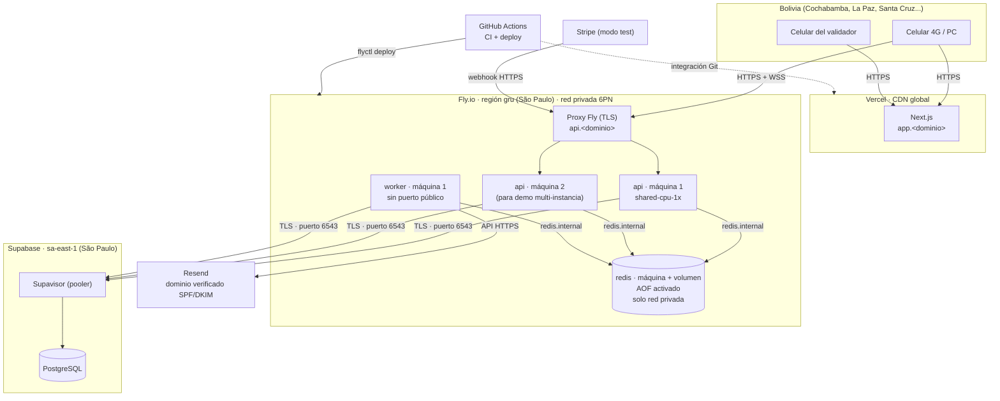

## 2. Regiones más cercanas a Bolivia (verificado)

| Servicio | ¿Tiene Sudamérica? | Región elegida | Comentario |
|---|---|---|---|
| **Fly.io** | ✅ `gru` São Paulo | `gru` | Única plataforma de cómputo de la lista con región en Sudamérica |
| **Supabase** | ✅ `sa-east-1` São Paulo | `sa-east-1` | Misma ciudad que Fly `gru`: latencia API↔BD de pocos ms |
| **Vercel** | ✅ `gru1` São Paulo (región de funciones) | CDN global + funciones en `gru1` si el plan lo permite (verificar en Hobby) | Las funciones van por defecto a `iad1` (Washington). Casi todo lo nuestro es estático o SSR liviano |
| **Render** | ❌ Oregon, Ohio, Virginia, Frankfurt, Singapur | — | Lo más cercano es Virginia/Ohio |
| **Railway** | ❌ US West, US East (Virginia), EU West (Ámsterdam), SE Asia (Singapur) | — | Lo más cercano es US East |
| **Upstash** | No confirmado en la página de precios | — | No pudimos verificar `sa-east-1`. Ver la consola |
| **Resend** | N/A (API) | — | La latencia del email no importa: es asíncrono |

**Por qué importa la región:** la latencia de red desde Bolivia a São Paulo suele ser bastante menor que a Virginia (EE. UU.). **Mídanla** desde Cochabamba con `curl -w "%{time_connect}"` contra cada región en la semana 1 y anoten el resultado aquí. Cada reserva, cada delta del WS y cada reconexión pagan esa latencia de ida y vuelta.

Más importante todavía: **API y BD en la misma región.** Una reserva hace 2–4 consultas. Si la API está en Virginia y la BD en São Paulo, cada consulta cruza el continente.

## 3. Free tiers y precios verificados

| Proveedor | Plan | Qué incluye (oficial) | Trampa para nuestro caso |
|---|---|---|---|
| **Vercel** | Hobby (gratis) | 100 GB de transferencia, 1M de invocaciones, duración máx. de 300 s | **Solo uso personal no comercial.** Cobrar a visitantes = uso comercial. Sirve para el proyecto universitario. Producción necesita Pro |
| **Fly.io** | Pago por uso | **Sin free tier para organizaciones nuevas.** Prueba de 2 h de máquina o 7 días | Requiere tarjeta. Costo estimado: 3–4 máquinas pequeñas siempre encendidas + volumen de 1 GB. **Calculen con la calculadora de Fly** (estimamos ~US$5–10/mes) |
| **Supabase** | Free | 500 MB de BD, 5 GB de egress, **2 proyectos activos**, región São Paulo | **Se pausa tras 1 semana de inactividad.** Entrar al panel antes de la demo. Free no lista límites de conexiones directas: usar el pooler |
| **Railway** | Trial / Free / Hobby | Trial: US$5 únicos. Free: US$1/mes (0,5 GB RAM por servicio). Hobby: US$5/mes con US$5 de uso incluido | Sin región en Sudamérica. El Free de US$1 no alcanza para API + Worker + Redis 24/7 |
| **Render** | Free | 750 h/mes por workspace. Se duerme tras 15 min sin tráfico (incluye mensajes WS). Arranque de ~1 min. Postgres gratis de 1 GB que **expira a los 30 días**. Key Value en memoria (**pierde datos al reiniciar**) | Sin workers gratis. Un arranque en frío de ~1 min en plena demo es fatal |
| **Upstash Redis** | Free | 256 MB, **500K comandos/mes**, 10 GB de ancho de banda | **BullMQ consulta Redis constantemente aunque no haya jobs** (lo advierte la doc de Upstash). Hay usuarios que agotaron la cuota en reposo. **No apto** para BullMQ en el plan gratis |
| **Resend** | Free | **3.000 emails/mes, máx. 100/día**, 3 dominios, 30 días de logs | 100/día: en los ensayos de demo **no** usen emails reales masivos (usar Mailpit en local) |
| **SendGrid** | — | **Retiró el plan gratis en 2025.** Ahora es una prueba de 60 días | Descartado |
| **Stripe** | Modo test | Gratis, sin activar la cuenta | Bolivia **no** figura entre los países con cuenta Stripe. Solo modo test. Ver doc 13 |

## 4. Elección final

**Problema:** queremos baja latencia para Bolivia, API + Worker + Redis **siempre encendidos** (sin arranques en frío en la demo), y un presupuesto de ≤ US$10/mes.

**Opciones:**
1. **Fly.io `gru`** (API + Worker + Redis) + Supabase `sa-east-1` + Vercel + Resend.
2. **Railway Hobby** (API + Worker + Redis, US East) + Supabase + Vercel + Resend.
3. Todo gratis: Render (API) + Upstash (Redis) + Worker local.

**Elección:** **opción 1**, con la **opción 2 como plan B** si la tarjeta o el costo de Fly dan problemas.

**Por qué:**
- Fly es la única plataforma con cómputo en São Paulo, en la **misma ciudad** que Supabase.
- Redis en Fly dentro de la **red privada**: sin límites por comando (BullMQ consume en reposo), sin exponer Redis a Internet y con latencia mínima.
- Varias máquinas de la API en una línea (`fly scale count 2`): demostramos el WebSocket multi-instancia de verdad.
- La opción 3 se descarta: los arranques en frío de Render, la cuota de comandos de Upstash y un Worker en la laptop de alguien hacen la demo frágil.

**Plan B (Railway):** misma arquitectura, región US East. Interfaz más simple y plantilla de Redis. Costo fijo de US$5 con US$5 de uso incluido. Se paga con latencia mayor desde Bolivia.

**Plan C (contingencia el día de la demo):** todo en una laptop con Docker + `stripe listen` para los webhooks. Debe estar ensayado.

## 5. Dominio y DNS (decidido: el equipo tiene o comprará un dominio)

| Registro | Apunta a | Para |
|---|---|---|
| `app.<dominio>` | Vercel (CNAME) | Frontend |
| `api.<dominio>` | Fly (`fly certs add api.<dominio>`) | API + WebSocket |
| TXT/MX/CNAME de Resend (SPF, DKIM, DMARC) | Resend | Que los emails **no caigan en spam** |

Usar **subdominios del mismo dominio** simplifica CORS y, si en el futuro se usan cookies, que sean *same-site*.

## 6. Variables de entorno

| Variable | Dónde | Ejemplo / nota | Secreto |
|---|---|---|---|
| `NODE_ENV` | api, worker | `production` | No |
| `APP_ROLE` | api, worker | `api` o `worker` (mismo build, distinto arranque) | No |
| `DATABASE_URL` | api, worker | Pooler de Supabase, modo transacción (`:6543`, `?pgbouncer=true&connection_limit=10`) | ✅ |
| `DIRECT_URL` | CI (migraciones) | Pooler en modo sesión (`:5432`) para `prisma migrate deploy` | ✅ |
| `REDIS_URL` | api, worker | `redis://:<pass>@<app-redis>.internal:6379` | ✅ |
| `JWT_SECRET` | api | ≥ 32 bytes aleatorios | ✅ |
| `JWT_EXPIRES_IN` | api | `60m` | No |
| `QR_SIGNING_PRIVATE_KEY` | **solo worker** | Ed25519 en PEM | ✅ |
| `QR_SIGNING_PUBLIC_KEY` | api | Ed25519 en PEM | No |
| `PAYMENT_PROVIDER` | api | `stripe` \| `simulador` | No |
| `STRIPE_SECRET_KEY` | api | `sk_test_...` (**nunca** `sk_live_`; la API se niega a arrancar si detecta `live`) | ✅ |
| `STRIPE_WEBHOOK_SECRET` | api | `whsec_...` | ✅ |
| `SIMULADOR_WEBHOOK_SECRET` | api | HMAC del simulador | ✅ |
| `RESEND_API_KEY` | worker | `re_...` | ✅ |
| `EMAIL_FROM` | worker | `Entradas <entradas@<dominio>>` | No |
| `CORS_ORIGINS` | api | `https://app.<dominio>` | No |
| `RESERVA_TTL_SEGUNDOS` | api | `300` (en tests: `5`) | No |
| `TZ_DISPLAY` | api, worker, frontend | `America/La_Paz` | No |
| `NEXT_PUBLIC_API_URL` | frontend | `https://api.<dominio>` | No |
| `NEXT_PUBLIC_WS_URL` | frontend | `wss://api.<dominio>` | No |

Reglas: los secretos van en `fly secrets set` / Vercel Env / GitHub Secrets, **nunca** en el repo. Se versiona un `.env.example` sin valores. El servidor corre con `TZ=UTC`.

## 7. CI/CD con GitHub Actions

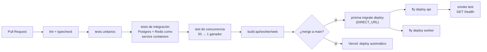

| Paso | Detalle | Por qué |
|---|---|---|
| Service containers | `postgres:16` y `redis:7` en el job | Los tests de concurrencia **deben** correr contra un Postgres real. Un mock no tiene locks |
| Test de concurrencia obligatorio | Bloquea el merge si falla | Es la propiedad central del proyecto |
| Migraciones antes del deploy | Migraciones **compatibles hacia atrás** (añadir columnas, no renombrar en un solo paso) | Durante el deploy conviven la versión vieja y la nueva |
| Deploy por rama | `main` → producción de la demo. PR → Vercel preview | — |
| Protección de rama | `main` exige PR + CI en verde + 1 revisión | Trabajo en equipo |

## 8. Desarrollo local con Docker

Servicios del entorno local (se definen en la semana 1):

| Servicio | Imagen | Para |
|---|---|---|
| postgres | `postgres:16` | BD |
| redis | `redis:7` con AOF | Cola y pub/sub |
| mailpit | `axllent/mailpit` | Ver los emails sin gastar la cuota de Resend |
| stripe-cli | `stripe/stripe-cli` | `stripe listen --forward-to localhost:3000/webhooks/pagos/stripe` |
| bull-board | dentro de la API en `/admin/colas` (protegido por rol) | Ver la cola en la demo |
| api, worker, web | Se corren con `npm run dev` fuera de Docker (más rápido para desarrollar) | — |

## 9. Observabilidad mínima

- **Logs:** JSON con `pino`, con `requestId`, `ordenId`, `eventoId` y `instancia` (`FLY_MACHINE_ID`). Se ven con `fly logs`.
- **Métricas:** endpoint `/metrics` (formato Prometheus) con:
  - `reservas_total{resultado="ok|conflicto|rate_limited"}`
  - `webhooks_total{resultado="nuevo|duplicado|firma_invalida"}`
  - `cola_jobs{cola, estado}` · `ws_conexiones{instancia}` · `http_request_duration_seconds`
- **Panel de demo:** página `/admin/demo` en el frontend que consulta `/metrics` cada 2 s y muestra contadores grandes. Grafana **no aporta lo suficiente** para el esfuerzo en 6 semanas: es opcional si sobra tiempo.

## 10. Fuentes (consultadas el 16/10/2026)

- Stripe, países soportados: <https://stripe.com/global>
- Render, regiones: <https://render.com/docs/regions> · free: <https://render.com/docs/free>
- Railway, regiones: <https://docs.railway.com/reference/regions> · planes: <https://docs.railway.com/reference/pricing/plans>
- Fly.io, regiones: <https://fly.io/docs/reference/regions/> · precios: <https://fly.io/docs/about/pricing/>
- Supabase, precios: <https://supabase.com/pricing> · regiones: <https://supabase.com/docs/guides/platform/regions>
- Upstash, precios Redis: <https://upstash.com/pricing/redis> · BullMQ en Upstash: <https://upstash.com/docs/redis/integrations/bullmq>
- Resend, precios: <https://resend.com/pricing>
- Vercel, límites: <https://vercel.com/docs/limits> · Hobby: <https://vercel.com/docs/plans/hobby> · uso justo: <https://vercel.com/docs/limits/fair-use-guidelines> · regiones: <https://vercel.com/docs/regions>
- SendGrid, retiro del plan gratis: <https://www.twilio.com/en-us/changelog/sendgrid-free-plan>
- Consumo de BullMQ en Upstash (foro de Fly): <https://community.fly.io/t/pay-as-you-go-pricing-for-redis-databases/16253>


# 08 — Patrones de diseño y conceptos de system design

Cada fila responde: **¿qué es?**, **¿dónde aparece en nuestro sistema?** y **¿qué problema resuelve aquí?**

## 1. Patrones de diseño (código)

| Patrón | Qué es | Dónde aparece | Problema que resuelve |
|---|---|---|---|
| **Adapter** | Envuelve una API externa detrás de una interfaz propia | `StripeTestAdapter`, `SimuladorAdapter`, `QrBancarioAdapter` implementan `ProveedorPago` | El dominio no depende de Stripe, y cambiar a un QR bancario no toca Órdenes |
| **Strategy** | Elegir el algoritmo en tiempo de ejecución | `PAYMENT_PROVIDER=stripe\|simulador` elige el adaptador al arrancar | Mismo flujo con distintos proveedores, en tests y en la demo |
| **Puertos y adaptadores (hexagonal, ligero)** | El núcleo define interfaces y la infraestructura las implementa | `ProveedorPago`, `EnviadorEmail` (Resend o Mailpit), `FirmadorQr` | Probar la lógica con dobles de prueba sin red |
| **Repository** | Acceso a datos detrás de métodos con nombre del dominio | `AsientosRepository.reservarAtomico(tx, eventoId, ids, ordenId)` | Encapsula el SQL crítico en un solo lugar probado |
| **Unit of Work / Transacción explícita** | Un conjunto de cambios que se confirma o se descarta junto | `prisma.$transaction(async (tx) => ...)` en reservar y en el webhook | Atomicidad entre asientos, orden, entradas y outbox |
| **State machine** | Transiciones permitidas explícitas | Estados de asiento, orden y entrada (doc 04), validados con `WHERE estado = <origen>` | Impide transiciones ilegales (p. ej. PAGADA → EXPIRADA) |
| **Observer / Pub-Sub** | Los publicadores no conocen a los suscriptores | Delta del mapa → Redis pub/sub → todas las instancias → sockets de la sala | Desacopla "algo cambió" de "a quién avisar" |
| **Guard / Interceptor (NestJS)** | Lógica transversal antes o después del handler | `JwtGuard`, `RolesGuard`, `ThrottlerGuard`, interceptor de `Idempotency-Key` y de `requestId` | Seguridad y observabilidad sin repetir código |
| **Dependency Injection** | Las dependencias se inyectan, no se construyen dentro | Módulos de NestJS | Tests: inyectar `SimuladorAdapter` o un reloj falso |
| **Template Method / Pipeline** | Pasos fijos con partes variables | Procesadores de jobs: cargar → procesar → marcar → encadenar el siguiente job | Uniformidad en el manejo de errores y reintentos |

## 2. Patrones de sistemas distribuidos

| Patrón / concepto | Qué es | Dónde aparece | Problema que resuelve |
|---|---|---|---|
| **Fuente única de verdad** | Un solo sistema decide el estado autoritativo | Postgres para asientos, órdenes y entradas | Evita discrepancias entre Redis, la caché y la BD |
| **Compare-and-set / UPDATE condicional** | Escribir solo si el estado es el esperado, en una operación | `UPDATE ... WHERE estado='LIBRE'` (doc 04) | Condición de carrera *check-then-act* |
| **Lease / Lock lógico con TTL** | Propiedad temporal que vence sola | `estado=RESERVADO` + `expires_at` | Reserva de 5 min sin locks de BD largos y sin depender de que el cliente "devuelva" el asiento |
| **Expiración perezosa** | Tratar como vencido al leer, sin esperar a la limpieza | `OR (estado='RESERVADO' AND expires_at < now())` | La correctitud no depende del job |
| **Idempotent Receiver** | El consumidor ignora mensajes ya procesados | `webhook_eventos UNIQUE`, `Idempotency-Key`, `jobId` de BullMQ | Entrega al-menos-una-vez sin efectos dobles |
| **Transactional Outbox** | Guardar el evento en la misma transacción que el cambio y publicarlo después | Tabla `outbox` + relay | Doble escritura BD + cola |
| **Competing Consumers** | Varios workers consumen la misma cola | N Workers con BullMQ | Escalar el procesamiento de PDF y email |
| **Retry con backoff exponencial + jitter** | Reintentar espaciando y con aleatoriedad | Jobs de BullMQ, reconexión de Socket.IO, cliente HTTP | Fallos transitorios sin estampida |
| **Dead Letter Queue** | Donde terminan los mensajes que fallan siempre | Estado *failed* de BullMQ + `envios_email.FALLIDO` | Que un mensaje "venenoso" no se reintente para siempre y quede visible |
| **Bulkhead (compartimentos)** | Aislar recursos para que un fallo no hunda todo | Proceso Worker separado de la API. Colas separadas para PDF y email | Un Resend lento no frena las reservas |
| **Degradación elegante** | Seguir funcionando con menos calidad | WS → polling. Rate limit en Redis → memoria local | Fallos parciales sin caída total |
| **Rate limiting (token bucket / ventana deslizante)** | Limitar peticiones por clave | `@nestjs/throttler` + Redis | Bots, reintentos agresivos y fuerza bruta en el login |
| **Control de admisión / sala de espera** | Admitir carga a ritmo sostenible | Diseño en doc 06 §5 | La manada del minuto cero |
| **Escalado horizontal sin estado** | Copias idénticas detrás de un balanceador | Máquinas `api` en Fly | Más capacidad sin rediseñar |
| **Backplane pub/sub para WS** | Bus compartido entre instancias con conexiones persistentes | `@socket.io/redis-adapter` | Clientes en instancias distintas |
| **Coalescing / batching** | Agrupar muchos eventos pequeños en uno | Deltas del mapa cada 250 ms | El fan-out del WS |
| **Microcaching** | Caché de 1 s para lecturas idénticas masivas | Snapshot del mapa por instancia | Miles de lecturas iguales por segundo |
| **Versionado / números de secuencia** | Cada cambio lleva una versión creciente | `asientos.version`, `eventos.mapa_version` | Detectar mensajes perdidos o desordenados y resincronizar |
| **Consistencia eventual (en el cliente)** | Las réplicas convergen con el tiempo | El mapa del navegador es una réplica que converge | Aceptable: la BD decide en el momento de reservar |
| **Consistencia fuerte (en la BD)** | Lecturas y escrituras linealizables sobre una fila | Reserva y validación en el primario de Postgres | Sin sobreventa |
| **CQRS (idea, no framework)** | Separar el modelo de escritura del de lectura | Escritura: tablas normalizadas. Lectura: snapshot compacto + deltas | Optimizar la lectura masiva sin complicar la escritura |
| **Reconciliación** | Comparar periódicamente con la fuente externa | Job futuro que consulta `consultarEstado` en pagos EN_PROCESO > 10 min | Webhooks perdidos (sobre todo con el QR bancario) |
| **Saga / compensación (no usado, explicado)** | Transacciones distribuidas con pasos compensatorios | Lo necesitaríamos con microservicios (doc 03 §5) | Justifica por qué un monolito simplifica |
| **Strangler Fig** | Extraer partes de un monolito gradualmente | Plan de la Fase 4: extraer Validación y Notificaciones | Evolución sin reescritura total |
| **Defensa en profundidad** | Varias capas de protección | UPDATE condicional + UNIQUE parcial + CHECK + idempotencia | Un bug en una capa no rompe la invariante |
| **Firma digital / tokens autocontenidos** | Verificar autenticidad sin consultar al emisor | JWT (HMAC) para sesiones. QR con Ed25519 | Sesiones sin estado en el servidor y QR infalsificable |

## 3. Teorema CAP aplicado (explicación breve)

Ante una **partición de red** (P), hay que elegir entre **Consistencia** (C) y **Disponibilidad** (A).

| Parte del sistema | Elección | Ejemplo |
|---|---|---|
| Reserva y venta | **C**: si la API no llega a Postgres, responde 503. **No** "reserva a ciegas" | Sin BD no se vende nada. Mejor no vender que vender dos veces |
| Mapa en vivo | **A**: si Redis o WS fallan, se muestra el último estado conocido + polling | Un mapa algo desactualizado es aceptable |
| Email | **A** con consistencia eventual: llega más tarde | El comprador ve la entrada en la web |
| Validación en puerta | **C** (versión actual): sin conexión no se marca USADA. Futuro: modo offline con riesgo controlado | Trade-off que decide el organizador |

## 4. Mapa: concepto → documento

| Concepto | Doc |
|---|---|
| Concurrencia, locks, estados, expiración | 04 |
| Idempotencia, outbox, reintentos, adapter de pagos | 05 |
| Escalado, fan-out, rate limiting, CAP en carga | 06 |
| Despliegue, regiones, CI/CD | 07 |
| Restricciones e índices | 09 |
| Cómo se prueba cada patrón | 10 |


# 09 — Modelo de datos

## 1. Convenciones

| Convención | Regla | Ejemplo | Por qué |
|---|---|---|---|
| **Dinero** | `bigint` en **centavos** + `moneda char(3) DEFAULT 'BOB'` | Bs 150,50 → `15050` | `0.1 + 0.2 = 0.30000000000000004` en float. Con enteros la suma es exacta. `bigint` sobra, pero evita sorpresas al sumar la recaudación |
| **Fechas** | `timestamptz` (se guarda en UTC) | `2026-11-22 01:00:00+00` = sáb. 21/11 21:00 en Bolivia | Comparar instantes sin ambigüedad. La conversión a `America/La_Paz` se hace solo al mostrar |
| **Hora del servidor** | Las comparaciones de vencimiento usan `now()` de Postgres | `expires_at < now()` | Un solo reloj autoritativo |
| **IDs** | `uuid` (v7 si está disponible, si no v4) para entidades expuestas. `bigserial` para tablas internas (outbox, eventos de webhook) | `entradas.id` va en el QR | No enumerables (nadie adivina la entrada 1235 a partir de la 1234) |
| **Estados** | `text` + `CHECK (estado IN (...))` (o enum de Postgres) | — | Legible en logs y migraciones simples |
| **Nombres** | `snake_case`, en español | `orden_items` | Coherencia con el dominio |
| **Teléfono** | `text` E.164 opcional, `CHECK (telefono ~ '^\+591[0-9]{8}$')` | `+59171234567` | Formato boliviano. Opcional por minimización de datos |

## 2. Diagrama ER

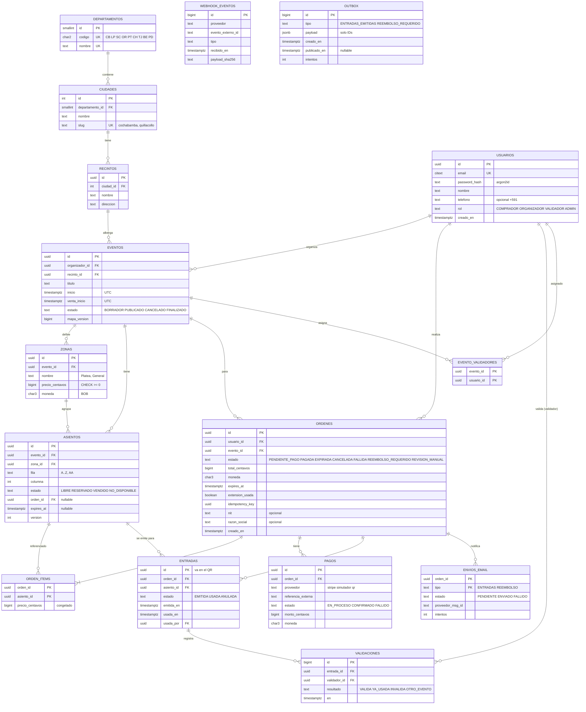

## 3. Ciudad y departamento: listos para la expansión

- **Semilla inicial:** los 9 departamentos (`CB` Cochabamba, `LP` La Paz, `SC` Santa Cruz, `OR` Oruro, `PT` Potosí, `CH` Chuquisaca, `TJ` Tarija, `BE` Beni, `PD` Pando) y las ciudades de Cochabamba (Cochabamba, Quillacollo, Sacaba...).
- **Filtro:** `GET /eventos?ciudad=cochabamba` resuelve el `slug` y hace un JOIN `eventos → recintos → ciudades`. Con `?departamento=CB` lista todo el departamento.
- **Expandir a Tarija** = insertar filas en `ciudades` y crear recintos. Cero cambios de código (RNF-14).
- **¿Por qué no un `text ciudad` libre en el evento?** Porque "Cbba", "Cochabamba" y "cochabamba " serían tres ciudades distintas, y el filtro fallaría.

## 4. Restricciones clave (el corazón de la correctitud)

| Restricción | SQL (resumen) | Protege |
|---|---|---|
| Asiento único en el mapa | `UNIQUE (evento_id, fila, columna)` en `asientos` | No hay dos "F-12" en el mismo evento |
| Una entrada válida por asiento | `CREATE UNIQUE INDEX ... ON entradas(asiento_id) WHERE estado IN ('EMITIDA','USADA')` | **RN-01**, la invariante principal |
| Coherencia de estado | `CHECK` de estado / `orden_id` / `expires_at` (doc 04 §4.2) | Estados imposibles |
| Webhook procesado una vez | `UNIQUE (proveedor, evento_externo_id)` en `webhook_eventos` | Duplicados del proveedor |
| Un cobro, un pago | `UNIQUE (proveedor, referencia_externa)` en `pagos` | Dos eventos distintos del mismo cobro |
| Idempotencia de la reserva | `UNIQUE (usuario_id, idempotency_key)` en `ordenes` | Doble clic y reintentos de red |
| Una orden pendiente por evento | `CREATE UNIQUE INDEX ... ON ordenes(usuario_id, evento_id) WHERE estado='PENDIENTE_PAGO'` | **RN-04** (acaparamiento) |
| Un ítem por asiento por orden | PK `(orden_id, asiento_id)` | Asiento repetido en la misma orden |
| Montos no negativos | `CHECK (precio_centavos >= 0)`, `CHECK (total_centavos >= 0)` | Errores de signo |
| Moneda | `CHECK (moneda = 'BOB')` (por ahora) | Mezclar monedas |
| Email único | `citext UNIQUE` | `Ana@x.com` = `ana@x.com` |
| Un email por orden y tipo | PK `(orden_id, tipo)` en `envios_email` | Doble envío |

## 5. Índices

| Índice | Consulta que acelera |
|---|---|
| `asientos (evento_id, estado)` | Snapshot del mapa y conteos del panel |
| `asientos (expires_at) WHERE estado='RESERVADO'` (parcial) | Job `liberar-vencidas`: solo indexa lo reservado (pequeño) |
| `asientos (orden_id)` | Confirmar el pago: `WHERE orden_id = $1` |
| `eventos (estado, inicio)` + `recintos (ciudad_id)` | Listado por ciudad |
| `ordenes (estado, expires_at) WHERE estado='PENDIENTE_PAGO'` | Marcar órdenes EXPIRADAS |
| `outbox (id) WHERE publicado_en IS NULL` (parcial) | Relay: solo las pendientes |
| `entradas (orden_id)` | "Mis entradas", generar el PDF |

**¿Por qué índices parciales?** En el pico, de 15.000 asientos quizá 2.000 están RESERVADOS. Un índice que solo incluye esos es pequeño, cabe en memoria y el job lo recorre en milisegundos.

## 6. Ejemplos de datos

```text
departamentos: (1, 'CB', 'Cochabamba')
ciudades:      (1, 1, 'Cochabamba', 'cochabamba'), (2, 1, 'Quillacollo', 'quillacollo')
recintos:      (r1, 1, 'Estadio Félix Capriles', 'Av. Libertador Bolívar')
eventos:       (e42, org1, r1, 'Concierto de Primavera', '2026-11-22 01:00Z', '2026-11-01 14:00Z', 'PUBLICADO', 812)
                -- se muestra: sábado 21/11/2026 21:00 · venta: domingo 01/11 10:00 (hora de Bolivia)
zonas:         (z1, e42, 'Platea', 30000, 'BOB')   -- Bs 300,00
asientos:      (a1, e42, z1, 'F', 12, 'RESERVADO', o77, '2026-11-01 14:05:00Z', 8)
ordenes:       (o77, ana, e42, 'PENDIENTE_PAGO', 60000, 'BOB', '2026-11-01 14:05Z', false, <uuid>, NULL, NULL)
```

## 7. Datos personales (minimización)

| Dato | ¿Se guarda? | Motivo |
|---|---|---|
| Email | Sí | Login + envío de la entrada |
| Nombre | Sí | Saludo en el email y el PDF |
| Teléfono | Opcional | Contacto. No se usa para nada crítico |
| CI (carnet) | **No** | No lo necesitamos. Si un organizador lo exige, sería una decisión futura con consentimiento explícito |
| Contraseña | Solo el **hash argon2id** | Ni el equipo puede verla |
| Tarjeta | **Nunca** | La maneja el proveedor (Stripe Checkout / banco) |
| NIT / razón social | Opcional, en la orden | Factura futura |
| QR | Solo `uuid` de entrada, `evento_id`, fecha de emisión y firma | Una foto filtrada del QR no expone a nadie |
| Logs | Sin contraseñas, tokens ni payloads completos de pago | Se registra el `payload_sha256` del webhook, no el cuerpo |

## 8. Migraciones

- Prisma Migrate genera migraciones SQL versionadas en el repo.
- Los **índices parciales, CHECK complejos y `citext`** se agregan con SQL manual dentro de la migración (Prisma no los expresa todos en su esquema). Esto es normal y se documenta en un comentario en la migración.
- Regla para CI: las migraciones deben ser **compatibles hacia atrás** (doc 07).


# 10 — Pruebas y demo

## 1. Estrategia

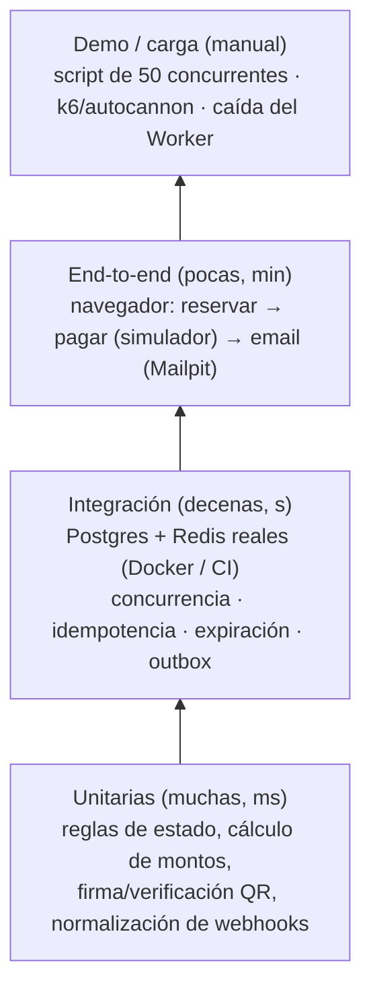

**TDD obligatorio** en concurrencia e idempotencia: el test se escribe **antes** que la implementación y debe fallar primero. Ejemplo: escribir el test de "50 → 1" contra una implementación ingenua (`SELECT` y luego `UPDATE`), ver que **falla** (gana más de uno) y recién después implementar el UPDATE condicional. **Ese "rojo → verde" es material de la presentación:** muestra que el test detecta el bug de verdad.

> **Por qué los tests de concurrencia NO usan mocks:** un mock de la BD no tiene locks, ni aislamiento, ni re-evaluación del WHERE. Probaríamos nuestro mock, no Postgres.

## 2. Casos de prueba críticos

### 2.1 Concurrencia (doc 04)
| ID | Escenario | Resultado esperado |
|---|---|---|
| C-01 | 50 `reservar([F-12])` concurrentes (`Promise.all`, 50 conexiones distintas) | Exactamente **1** éxito y 49 conflictos. En BD: 1 orden PENDIENTE, F-12 RESERVADO con ese `orden_id` |
| C-02 | Órdenes con asientos solapados {1,2,3} y {3,4,5} concurrentes, repetido 100 veces | En cada ronda una gana completa y la otra 409. **Nunca** reservas parciales |
| C-03 | {1,2} y {2,1} concurrentes, 100 veces | Sin deadlock (el test falla si tarda > 5 s) |
| C-04 | Reserva con `expires_at` en el pasado (forzado por SQL) **sin** correr el job | Otra orden puede reservar el asiento (expiración perezosa) |
| C-05 | El job `liberar-vencidas` corre en 2 procesos a la vez sobre 1.000 vencidos | Cada asiento se libera exactamente una vez. Los deltas publicados no se duplican en estado final |
| C-06 | 20 reservas con la misma `Idempotency-Key` | 1 orden. Las 20 respuestas devuelven el mismo `ordenId` |
| C-07 | Un usuario intenta una 2.ª orden pendiente en el mismo evento | 409 `ORDEN_PENDIENTE_EXISTENTE` |

### 2.2 Idempotencia y pagos (doc 05)
| ID | Escenario | Resultado esperado |
|---|---|---|
| P-01 | Mismo webhook ×5 **en paralelo** (simulador `duplicar`) | 5 × HTTP 200. 1 orden PAGADA. N entradas (N = asientos). 1 fila outbox. Métrica `webhooks_total{resultado="duplicado"} = 4` |
| P-02 | Webhook con firma inválida | 400. Nada cambia |
| P-03 | Webhook llega tarde, asiento todavía con su `orden_id` | Orden PAGADA (re-captura) |
| P-04 | Webhook llega tarde, asiento tomado por otro | REEMBOLSO_REQUERIDO. 0 entradas nuevas. Outbox de disculpa |
| P-05 | `FALLIDO` llega después de `EXITOSO` | La orden sigue PAGADA |
| P-06 | Monto del webhook ≠ total de la orden | REVISION_MANUAL. 0 entradas |
| P-07 | Dos eventos distintos con la misma `referencia_externa` | 1 pago, 1 conjunto de entradas |
| P-08 | Arranque con `STRIPE_SECRET_KEY=sk_live_...` | La API **se niega a arrancar** |

### 2.3 Outbox, cola y Worker
| ID | Escenario | Resultado esperado |
|---|---|---|
| W-01 | **Worker detenido**, 3 compras completas | Las 3 órdenes quedan PAGADAS y las entradas visibles en "Mis entradas". 3 jobs en espera en la cola |
| W-02 | Se reinicia el Worker | Los 3 jobs se procesan. 3 emails en Mailpit en < 2 min |
| W-03 | **Redis detenido** durante una compra | La compra se completa. La fila de outbox queda pendiente. Al volver Redis, se publica y procesa |
| W-04 | El relay publica dos veces la misma fila (forzado) | 1 solo job (mismo `jobId`) |
| W-05 | Resend devuelve 503 dos veces y luego 200 | 1 email. `intentos = 3` |
| W-06 | Resend devuelve 422 (email inválido) | Sin reintentos. `FALLIDO` |
| W-07 | El Worker muere (`kill -9`) a mitad de un PDF | BullMQ detecta el job *stalled* y lo reintenta. 1 email final (o duplicado aceptado y documentado) |

### 2.4 Tiempo real y reconexión
| ID | Escenario | Resultado esperado |
|---|---|---|
| R-01 | 2 navegadores conectados a **instancias distintas** (verificar `FLY_MACHINE_ID` en un log) | El cambio en A se ve en B en < 1 s |
| R-02 | DevTools → Offline 20 s → Online | Reconecta solo y pide el delta. El mapa queda igual que el snapshot del servidor |
| R-03 | WS bloqueado (forzar URL inválida) | Tras 3 intentos pasa a polling cada 5 s. El indicador muestra "modo ahorro" |
| R-04 | Delta con hueco de versión (forzado) | El cliente pide resync |
| R-05 | Throttling "Slow 4G" de Chrome | El mapa de 2.000 asientos carga en < 3 s y el JS inicial es < 200 KB |

### 2.5 Expiración
| ID | Escenario | Resultado esperado |
|---|---|---|
| X-01 | `RESERVA_TTL_SEGUNDOS=5`, reservar y esperar 6 s | Otro usuario reserva. El job lo marca EXPIRADA en ≤ 15 s y el mapa se actualiza |
| X-02 | Iniciar el pago extiende +2 min una sola vez | 2.º intento de extensión: sin cambio |
| X-03 | Contador del cliente con el reloj del celular adelantado 3 min | El contador usa el `expiresAt` del servidor menos el desfase medido en la respuesta. La BD decide igual |

### 2.6 Autorización y seguridad
| ID | Escenario | Resultado esperado |
|---|---|---|
| A-01 | Un comprador llama a `POST /admin/eventos` | 403 |
| A-02 | Un comprador cancela la orden de otro usuario | 404 (no se revela que existe) |
| A-03 | Un validador valida una entrada de un evento no asignado | `OTRO_EVENTO` |
| A-04 | JWT vencido o con firma alterada | 401 |
| A-05 | QR con payload modificado (`t` cambiado) | `INVALIDA` (la firma no coincide) |
| A-06 | 2 validadores escanean la misma entrada a la vez | 1 `VALIDA` + 1 `YA_USADA` |
| A-07 | 6 intentos de login en 1 min | El 6.º recibe 429 |
| A-08 | 11 reservas en 1 min del mismo usuario | La 11.ª recibe 429 con `Retry-After` |
| A-09 | Buscar datos personales en el QR decodificado | No hay email, nombre ni teléfono |

### 2.7 Latencia (medición, no aprobado/reprobado)
- Script con autocannon o k6 contra `POST /reservas` sobre asientos **distintos** (para medir rendimiento, no contención): 50 req/s durante 60 s. Registrar p50/p95/p99 del lado del servidor (`http_request_duration_seconds`) y del cliente desde Cochabamba.
- Repetir sobre **un mismo asiento** caliente para medir la latencia del 409.
- Comparar: API en `gru` vs. una prueba en `iad` (si hay tiempo), para justificar la región con datos.

| Medición | Valor (completar) |
|---|---|
| RTT Cochabamba → Fly `gru` | ___ ms |
| RTT Cochabamba → Railway US East (plan B) | ___ ms |
| p95 reserva (servidor) | ___ ms |
| p95 reserva (cliente en Cochabamba, 4G) | ___ ms |
| p95 propagación WS A→B | ___ ms |

## 3. Guion de la demo en vivo (≈ 12 min)

**Preparación (antes de clase):** el proyecto de Supabase está activo (¡no pausado!), 2 máquinas `api` + 1 `worker` en Fly, el evento "Demo SD" con 100 asientos publicado, 2 navegadores abiertos, la terminal con `fly logs` y el panel `/admin/demo` abierto. Plan C: la laptop con Docker lista.

| Min | Acto | Qué se ve | Concepto |
|---|---|---|---|
| 0–1 | Contexto | Diagrama del doc 00 | Arquitectura |
| 1–3 | **La carrera** | `node scripts/carrera.js --asiento F-12 --n 50` → `201: 1 · 409: 49`. Panel: `reservas_total{ok}=1, {conflicto}=49`. Logs de **ambas** instancias | UPDATE condicional, Postgres decide |
| 3–4 | **Mapa en vivo** | Navegador B ve F-12 en gris al instante, aunque está en otra instancia | Pub/sub multi-instancia |
| 4–6 | **Pago + webhook duplicado** | Pagar con el simulador en modo `duplicar=5`. Panel: `webhooks{duplicado}=4`. "Mis entradas": 1 entrada | Idempotencia |
| 6–8 | **Caída del Worker** | `fly machine stop <worker>`. Comprar 3 veces: todo OK. Bull Board: 3 jobs en espera. `fly machine start` → 3 emails llegan | Tolerancia a fallos, outbox |
| 8–9 | **Expiración** | Reserva con TTL de demo (60 s), sin pagar: se libera sola | Lease + expiración perezosa |
| 9–10 | **Red móvil** | DevTools Offline → Online: reconecta y resincroniza | Reconexión + versionado |
| 10–11 | **Puerta** | Escanear el QR desde el celular: VÁLIDA, y de nuevo: YA USADA 21:04 | CAS en la validación |
| 11–12 | Cierre | Tabla del doc 06 §8: demo vs. producción | Honestidad sobre la escala |

**Script `carrera.js` (descripción, se implementa en la semana 2):** crea 50 usuarios de prueba (o usa 50 tokens pre-generados para no chocar con el rate limit por usuario), dispara 50 `POST /reservas` en paralelo con `Promise.allSettled`, cuenta los códigos HTTP e imprime una tabla. Luego consulta `GET /asientos` y verifica que F-12 tenga **un** `orden_id`. Debe correr tanto en local como contra producción.

## 4. Definición de "hecho" (DoD) para cada historia
- [ ] Tests (unitarios o de integración) en verde en CI.
- [ ] Si toca concurrencia o idempotencia: test de concurrencia agregado **primero** (TDD).
- [ ] Logs con `requestId` en el camino nuevo.
- [ ] Textos en español de Bolivia, fechas en `America/La_Paz` y montos en Bs.
- [ ] Revisión de código por otro integrante.
- [ ] Documentación actualizada si cambió una decisión (nuevo ADR).


# 11 — Plan de 6 semanas

**Metodología:** Scrum adaptado, con **sprints de 1 semana**.
- **Lunes:** planificación (30 min). Se eligen las historias del backlog.
- **Diaria asíncrona** (mensaje en el grupo: ayer / hoy / bloqueos) + 15 min de llamada martes y jueves.
- **Viernes:** demo interna (cada uno muestra su slice funcionando **desplegado**) + retrospectiva (15 min).
- **TDD** en concurrencia e idempotencia. **Slices verticales:** cada persona entrega una funcionalidad completa (BD → API → UI), no "capas".

## 1. Equipo y responsabilidades

> Reemplazar "Integrante A/B/C" por nombres reales. Cada uno es **dueño** de un área, pero **todos** tocan BD, API y UI en sus slices.

| Persona | Área de responsabilidad | Slices principales |
|---|---|---|
| **Integrante A** | Núcleo de concurrencia y datos | Esquema de BD, reservas, expiración, tests de concurrencia, script de carrera |
| **Integrante B** | Frontend y tiempo real | Next.js, mapa de asientos, Socket.IO + reconexión/polling, panel de demo, validador con cámara |
| **Integrante C** | Pagos, Worker e infraestructura | Adaptadores de pago, webhook idempotente, outbox, Worker (QR/PDF/email), Docker, CI/CD, Fly/Supabase |

Rotación: en las semanas 4–5 cada uno **revisa** el código crítico de otro (A revisa pagos, C revisa reservas, B revisa expiración). Así los tres pueden explicar todo en la defensa.

## 2. Plan por semana

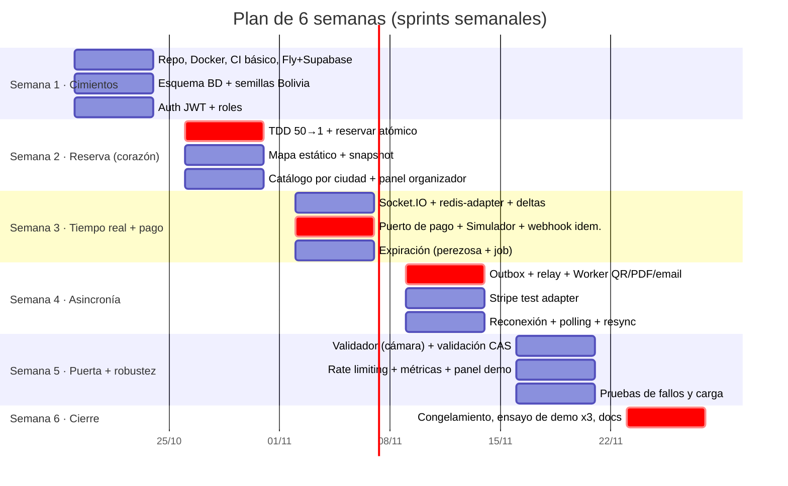

> Fechas de ejemplo (inicio el lunes 19/10/2026). Ajústenlas al calendario real de la materia.

### Semana 1 — Cimientos
| Entregable | Responsable | Criterio de aceptación |
|---|---|---|
| Monorepo (`apps/api`, `apps/worker`, `apps/web`, `packages/shared`), Docker local (Postgres, Redis, Mailpit), README "levantar en 5 min" | C | Otro integrante lo levanta desde cero |
| CI: lint + typecheck + tests con Postgres/Redis como servicios | C | Un PR con un test que falla no se puede mergear |
| Cuentas de Fly, Supabase (`sa-east-1`), Vercel y Resend + dominio. **Verificar de nuevo los free tiers y medir el RTT** desde Cochabamba | C | `GET /health` responde desde `api.<dominio>` |
| Esquema de BD y migraciones con todas las restricciones del doc 09. Semilla con los 9 departamentos y las ciudades de Cochabamba | A | Tests de restricciones: insertar 2 entradas válidas para un asiento **falla** |
| Registro y login con JWT y guard de roles. Next.js con login y layout | B | A-01 y A-04 en verde |

### Semana 2 — Reserva atómica (el corazón)
| Entregable | Resp. | Criterio |
|---|---|---|
| **Test C-01 primero (rojo)** con una implementación ingenua y después el UPDATE condicional (verde). C-02, C-03, C-06 y C-07 | A | Los tests corren en CI |
| `POST /reservas` con `Idempotency-Key` y `DELETE /ordenes/:id` | A | — |
| Script `carrera.js` (50 → 1) | A | Corre contra local y contra Fly |
| Panel organizador: recinto, evento, zonas, grilla y publicar | C | Publicar genera las filas `asientos` |
| Listado por ciudad + detalle + mapa (snapshot REST, sin tiempo real aún) con selección y reserva | B | Comprar el flujo "hasta reservar" en el celular |

**Hito de la semana 2:** la demo de la carrera **ya funciona**. Si el proyecto se cayera aquí, el núcleo está demostrado.

### Semana 3 — Tiempo real + pago
| Entregable | Resp. | Criterio |
|---|---|---|
| `SeatsGateway` con salas por evento, `redis-adapter`, deltas con versión y coalescing de 250 ms | B | R-01 con 2 instancias locales |
| Puerto `ProveedorPago` + `SimuladorAdapter` (OK, rechazo, duplicar, demora, desorden) + webhook idempotente (**TDD: P-01 primero**) | C | P-01..P-07 en verde |
| Expiración perezosa en la reserva y en el snapshot + job `liberar-vencidas` | A | C-04, C-05, X-01 en verde |

### Semana 4 — Asincronía y tolerancia a fallos
| Entregable | Resp. | Criterio |
|---|---|---|
| Outbox + relay (SKIP LOCKED, `jobId`) + Worker: firma QR Ed25519, PDF (es-BO, hora La Paz) y email (Mailpit/Resend) con reintentos | C | W-01..W-06 en verde |
| `StripeTestAdapter` (Checkout en modo test) + `stripe listen` en local | A | Pagar con 4242... emite la entrada |
| Reconexión con backoff + jitter, fallback a polling, resync por versión, contador de reserva | B | R-02..R-04 |

### Semana 5 — Puerta y robustez
| Entregable | Resp. | Criterio |
|---|---|---|
| App del validador (cámara web) + `POST /validaciones` con CAS + asignación de validadores | B | A-03, A-05, A-06 |
| Rate limiting con Redis (+ degradado a memoria) + `/metrics` + panel `/admin/demo` + Bull Board | A | A-07, A-08. El panel muestra contadores |
| Pruebas de fallos en el entorno desplegado (caída del Worker y de Redis) + mediciones de latencia (completar la tabla del doc 10) | C | W-01..W-03 en Fly |

### Semana 6 — Cierre (sin funcionalidades nuevas)
| Entregable | Resp. | Criterio |
|---|---|---|
| **Congelamiento de código el lunes.** Solo correcciones de errores | Todos | — |
| 3 ensayos completos de la demo (uno con el plan C local) | Todos | < 12 min, sin sorpresas |
| Docs actualizados, ADR finales, resumen docente y diapositivas | Todos | El docente puede leer el doc 00 solo |

## 3. Riesgos

| Riesgo | Prob. | Impacto | Mitigación |
|---|---|---|---|
| Free tiers que cambian o Supabase pausado el día de la demo | Media | Alto | Verificar en la semana 1 y el día anterior. Plan C local ensayado |
| Fly pide tarjeta o el costo supera lo previsto | Media | Medio | Plan B Railway (US$5). Alertas de gasto. Apagar máquinas fuera de las semanas de demo |
| El pooler de Supabase en modo transacción + Prisma da problemas (prepared statements) | Media | Medio | `pgbouncer=true` en la URL. Probarlo **en la semana 1**, no en la 5 |
| La concurrencia "funciona en local" pero no en el despliegue | Baja | Alto | `carrera.js` contra Fly desde la semana 2 |
| Un integrante se enferma o abandona | Media | Alto | Slices verticales completos (nada queda a medias en capas). Revisión cruzada para que otro sepa continuar |
| La cuota de Resend (100/día) se agota en los ensayos | Media | Bajo | Mailpit en local y Resend solo en el entorno desplegado. Pocos emails reales |
| El mapa es lento en celulares de gama baja | Media | Medio | Canvas/SVG simple. Probar en el celular más viejo del equipo en la semana 3 |
| Webhooks de Stripe no llegan en local | Media | Bajo | `stripe listen`. El simulador como respaldo |
| Alcance demasiado grande | Alta | Alto | Plan de recorte (abajo) |

## 4. Plan de recorte (si falta tiempo)

Se recorta **de abajo hacia arriba**. Lo de arriba **no se negocia**.

| Prioridad | Funcionalidad | Si falta tiempo... |
|---|---|---|
| 🔒 1 | Reserva atómica + test 50 → 1 | **Nunca se recorta** |
| 🔒 2 | Webhook idempotente con el simulador | **Nunca** |
| 🔒 3 | Outbox + Worker + demo de caída | **Nunca** (es el requisito de tolerancia a fallos) |
| 🔒 4 | Mapa en tiempo real multi-instancia | **Nunca** |
| 5 | Expiración con job | La expiración perezosa basta para la correctitud. El job puede ser más simple |
| 6 | Validador con cámara | Fallback: pegar el texto del QR en un input |
| 7 | Stripe test | Fallback: solo el simulador (el patrón Adapter se demuestra igual) |
| 8 | Polling de respaldo | Solo la reconexión de Socket.IO |
| 9 | PDF | Email con el QR como imagen embebida, sin PDF |
| 10 | Rate limiting distribuido | Throttler en memoria |
| 11 | Panel organizador completo | Eventos cargados por script de semilla |
| 12 | Sala de espera virtual | Solo diseño (ya está en el doc 06) |


# 12 — Glosario y errores comunes

## 1. Glosario

| Término | Definición breve | Ejemplo en nuestro sistema |
|---|---|---|
| **ACID** | Atomicidad, Consistencia, Aislamiento y Durabilidad de una transacción | Reservar 3 asientos + crear la orden: o todo o nada |
| **Adapter (patrón)** | Clase que traduce una interfaz externa a una propia | `StripeTestAdapter` implementa `ProveedorPago` |
| **ADR** | *Architecture Decision Record*: registro corto de una decisión y su porqué | `docs/adr/0002-...md` |
| **Al-menos-una-vez** | Garantía de entrega: el mensaje llega 1 o más veces | Webhooks y jobs de BullMQ |
| **Argon2id** | Algoritmo de hash de contraseñas, lento a propósito y resistente a GPU | `usuarios.password_hash` |
| **Backoff exponencial** | Esperar cada vez más entre reintentos (1 s, 2 s, 4 s...) | Reintentos de email |
| **Backplane** | Canal compartido entre instancias para retransmitir mensajes | Redis pub/sub para Socket.IO |
| **BullMQ** | Librería de colas de trabajo sobre Redis para Node.js | Colas `emitir-pdf`, `enviar-email` |
| **CAP** | Ante una partición de red, elegir consistencia o disponibilidad | Reservar: C. Mapa: A |
| **CAS (compare-and-set)** | Escribir solo si el valor actual es el esperado, en un paso | `UPDATE ... WHERE estado='LIBRE'` |
| **Centavos** | Unidad mínima, para guardar dinero como entero | Bs 25,50 = `2550` |
| **CGNAT** | Muchos clientes del operador móvil comparten una IP pública | Por eso el rate limit principal es por usuario |
| **Coalescing** | Juntar muchos eventos en uno solo cada X ms | Deltas del mapa cada 250 ms |
| **Cola de fallidos (DLQ)** | Lugar para mensajes que agotaron sus reintentos | Jobs *failed* en Bull Board |
| **Condición de carrera** | El resultado depende del orden temporal de operaciones concurrentes | Dos `SELECT` LIBRE seguidos de dos `UPDATE` |
| **Consistencia eventual** | Las copias convergen al mismo valor con el tiempo | El mapa en el navegador |
| **Deadlock** | Dos transacciones esperan cada una un lock que tiene la otra | Evitado con `ORDER BY id FOR UPDATE` |
| **Delta** | Solo los cambios desde una versión | `{desde:812, hasta:815, cambios:[...]}` |
| **Ed25519** | Algoritmo de firma digital asimétrica, rápido y con claves cortas | Firma del QR |
| **E.164** | Formato internacional de teléfono | `+59171234567` |
| **Expiración perezosa** | Considerar vencido algo al consultarlo, sin esperar a un proceso de limpieza | `expires_at < now()` en el WHERE de la reserva |
| **Fan-out** | Un mensaje que se reenvía a muchos destinatarios | 1 cambio → 20.000 sockets |
| **Fencing token** | Número creciente que protege contra dueños de locks vencidos | Por qué Redlock no basta sin la BD |
| **Fuente de verdad** | El sistema cuyo dato es el oficial | Postgres |
| **Idempotencia** | Repetir una operación tiene el mismo efecto que hacerla una vez | Webhook duplicado → 1 entrada |
| **Idempotency-Key** | Clave enviada por el cliente para deduplicar reintentos | UUID en `POST /reservas` |
| **Jitter** | Aleatoriedad añadida a los tiempos de espera | Reconexión de 1 s ± 30 % |
| **JWT** | Token firmado que lleva datos (`sub`, `rol`, `exp`) | `Authorization: Bearer ...` |
| **Lease** | Propiedad temporal que vence sola | Reserva de 5 minutos |
| **Monolito modular** | Una sola aplicación desplegable, dividida en módulos con fronteras | API NestJS |
| **Outbox** | Tabla donde se guarda, en la misma transacción, un evento que se publicará después | `outbox` → BullMQ |
| **p95** | El 95 % de las peticiones tarda menos que este valor | p95 de la reserva < 300 ms |
| **Pooler** | Intermediario que reutiliza conexiones a la BD | Supavisor de Supabase |
| **Pub/Sub** | Publicadores y suscriptores desacoplados por canales | Redis: canal por sala de evento |
| **Rate limiting** | Limitar cuántas peticiones acepta el sistema por clave y tiempo | 10 reservas/min por usuario |
| **READ COMMITTED** | Nivel de aislamiento por defecto de Postgres: cada sentencia ve lo ya confirmado | Re-evaluación del WHERE en UPDATE concurrentes |
| **Reconciliación** | Comparar periódicamente con el sistema externo para corregir diferencias | Consultar al banco los pagos sin callback |
| **Región** | Ubicación física de los servidores de un proveedor | `gru` / `sa-east-1` = São Paulo |
| **Saga** | Secuencia de transacciones locales con compensaciones | Lo que haría falta con microservicios |
| **SKIP LOCKED** | Opción de Postgres para saltar filas bloqueadas por otro en vez de esperar | Relay del outbox, job de expiración y reserva |
| **Slice vertical** | Funcionalidad completa de punta a punta (BD → API → UI) | "Reservar asiento" de una persona |
| **Snapshot** | Estado completo en un instante | Mapa entero con `version` |
| **Sticky session** | El balanceador envía siempre al mismo cliente a la misma instancia | Lo evitamos usando solo transporte websocket + polling REST |
| **Strangler Fig** | Extraer partes de un sistema viejo de forma gradual | Plan para extraer Validación |
| **Thundering herd (manada)** | Muchos clientes que actúan en el mismo instante | Apertura de la venta. Reconexión masiva |
| **TTL** | *Time to live*: tiempo de vida antes de vencer | 5 min de reserva |
| **Webhook** | Petición HTTP que un servicio externo envía para avisar de un evento | Stripe avisa "pago exitoso" |
| **WebSocket** | Conexión bidireccional persistente sobre TCP | Mapa en vivo |

## 2. Errores comunes (y cómo los evitamos)

### Concurrencia
| ❌ Error | Por qué está mal | ✅ Lo correcto |
|---|---|---|
| `SELECT` estado y, si está LIBRE, `UPDATE` en dos pasos | Condición de carrera *check-then-act* | Un único `UPDATE ... WHERE estado='LIBRE'` y revisar las filas afectadas |
| "Ya lo controlo en el frontend deshabilitando el botón" | Dos usuarios distintos o un script se lo saltan | La BD decide. El frontend solo mejora la experiencia |
| Usar Redis `SETNX` como verdad del asiento | Dos fuentes de verdad. TTL inseguro ante pausas | Redis solo para cola, pub/sub y rate limit |
| `SELECT ... FOR UPDATE` y esperar a que el usuario pague | Conexiones agotadas. Usuarios bloqueados | Estado RESERVADO + `expires_at` |
| Reservar los asientos de uno en uno en un bucle | Reservas parciales. Deadlocks | Una sentencia con `ANY($ids)` + `ORDER BY id` + todo o nada |
| Comparar el vencimiento con `new Date()` de Node | Relojes distintos entre instancias | `now()` de Postgres |
| Depender del job para liberar asientos | Si el Worker cae, los asientos quedan bloqueados | Expiración perezosa en la consulta |
| Probar la concurrencia con mocks | Los mocks no tienen locks | Postgres real en Docker o CI |
| Tests de concurrencia con **una** sola conexión compartida | Las sentencias se serializan en la conexión y nunca hay carrera real | Un pool con N conexiones o N clientes |

### Pagos e idempotencia
| ❌ Error | Por qué está mal | ✅ Lo correcto |
|---|---|---|
| Marcar PAGADA cuando el usuario vuelve a `/success` | La URL se puede visitar sin pagar | Solo el webhook verificado confirma |
| Parsear el JSON antes de verificar la firma | La firma es sobre los bytes exactos | `rawBody` en la ruta del webhook |
| Responder 500 al webhook duplicado | El proveedor reintenta para siempre | 200 si ya se procesó |
| Comprobar "¿ya procesado?" con un SELECT y luego INSERT | Carrera entre dos webhooks simultáneos | `INSERT ... ON CONFLICT DO NOTHING` dentro de la transacción |
| Encolar el email **antes** del COMMIT | El email sale aunque la transacción falle | Outbox |
| Encolar **después** del COMMIT sin outbox | Si la API cae entre los dos pasos, el email nunca sale | Outbox |
| Guardar montos como `float` / `numeric` en JS | Errores de redondeo (`0.1+0.2`) | Enteros en centavos (`bigint`) |
| Reintentar errores permanentes (422) | Gasta la cuota (100 emails/día) | Clasificar transitorio vs. permanente |
| Dejar la clave `sk_live_` en un `.env` | Cobros reales accidentales | La API se niega a arrancar con `live` |

### Tiempo real
| ❌ Error | Por qué está mal | ✅ Lo correcto |
|---|---|---|
| Reservar por WebSocket | Sin código de respuesta claro ni idempotencia, y se pierde si se cae el socket | REST para acciones y WS solo para informar |
| PUBLISH antes del COMMIT | Se anuncian estados que quizá nunca existan | Primero COMMIT, después PUBLISH |
| No resincronizar tras reconectar | Se pierden los cambios ocurridos durante el corte | Pedir el delta desde `versionLocal` |
| Enviar cada cambio a cada cliente en tiempo real | Fan-out de cientos de miles de mensajes/s | Coalescing + salas por zona |
| Reconexión sin jitter | Miles reconectan en el mismo ms | Backoff + jitter |
| Socket.IO long-polling con varias instancias sin sticky sessions | El handshake se reparte entre instancias y falla | `transports:['websocket']` + polling REST propio |

### Fechas, dinero y localización
| ❌ Error | ✅ Lo correcto |
|---|---|
| Guardar "21:00" sin zona horaria | `timestamptz` en UTC y mostrar en `America/La_Paz` |
| Usar la zona horaria del servidor (Fly/Vercel corren en UTC) | Zona explícita en `Intl.DateTimeFormat('es-BO', {timeZone:'America/La_Paz'})` |
| Mostrar `$300` o `300.00` | `Bs 300,00` con `Intl.NumberFormat('es-BO', {style:'currency', currency:'BOB'})` (verificar en el navegador que el símbolo salga como "Bs") |
| `ciudad` como texto libre | Tabla `ciudades` con FK |

### Seguridad y datos
| ❌ Error | ✅ Lo correcto |
|---|---|
| Poner el email o nombre en el QR | Solo el UUID de la entrada + la firma |
| Firmar el QR con HMAC y dar la clave a los validadores | Ed25519: los validadores solo tienen la pública |
| Loguear el body del webhook o los JWT | Loguear IDs y el hash del payload |
| IDs secuenciales en URLs públicas (`/entradas/1234`) | UUID |
| Exponer Redis a Internet | Red privada de Fly (`.internal`) |

### Proceso y proyecto
| ❌ Error | ✅ Lo correcto |
|---|---|
| Dejar el despliegue para la semana 5 | Desplegar en la semana 1 (`/health`) y ejecutar la carrera contra producción en la semana 2 |
| Repartir por capas ("yo el backend, tú el frontend") | Slices verticales: cada uno entrega funcionalidades completas |
| Agregar Kafka / microservicios / K8s "porque es distribuido" | Cada tecnología necesita un problema que resuelva (doc 03) |
| No ensayar la demo | 3 ensayos + plan C local |
| Olvidar que Supabase Free se pausa tras 1 semana inactivo | Revisarlo el día anterior |


# 13 — Pagos en Bolivia

> Investigación del **16/10/2026**. Las fuentes son oficiales cuando fue posible. Varias son **secundarias** (blogs de agencias locales y prensa) y se marcan como tales. **Antes de un lanzamiento real, todo esto se confirma directamente con el banco o la pasarela.**

## 1. ¿Por qué no Stripe en producción?

- La página oficial de Stripe con los países donde un negocio puede abrir una cuenta (<https://stripe.com/global>) **no incluye a Bolivia**. En Latinoamérica solo figuran **Brasil y México**.
- Consecuencia: un comercio boliviano **no puede** recibir cobros reales con Stripe a su nombre.
- **Uso en el proyecto:** solo el **modo test** de Stripe, que funciona sin activar la cuenta ni dar datos bancarios. Sirve para demostrar webhooks firmados, idempotencia y confirmación asíncrona con un proveedor real del mercado. **Nunca** se activa el modo live (la API se niega a arrancar con una clave `sk_live_`).
- **Moneda en test:** si el Checkout de Stripe en modo test no acepta BOB para la cuenta de prueba (no lo verificamos en su tabla de monedas), se usa USD **solo en el adaptador de Stripe**, con una conversión fija documentada. El dominio sigue en BOB.

## 2. Panorama actual (verificado y no verificado)

### 2.1 QR interoperable (QR Simple): el medio dominante

| Dato | Valor | Fuente |
|---|---|---|
| Operaciones QR en 2025 | **~892 millones** (+131 % frente a 2024) | BCB, Informe de Vigilancia (vía prensa: eju.tv) |
| Monto movido por QR en 2025 | **> Bs 357.747 millones** | BCB (vía eju.tv) |
| Personas que lo usan | ~3,7 millones | ASOBAN (vía prensa) |
| Comercios que lo aceptan | ~1,5 millones | ASOBAN (vía prensa) |
| Participación en pagos | Efectivo 85 % → 64 %, QR 15 % → 36 % (2020 → 2025) | Los Tiempos |
| Ritmo | ~28 pagos QR por segundo | BCB, vía Los Tiempos (jun. 2026) |
| Regulación | El BCB exige un estándar QR común e interoperable en todo el sistema financiero. Resolución de Directorio N.º 111/2024 sobre interoperabilidad | FLAR 2025, BCB |

**Cómo funciona para un comercio:**
- **QR estático** (sin monto): el comercio tiene un QR fijo y el cliente escribe el monto. Requiere **verificación manual**: no sirve para nosotros.
- **QR dinámico** (con monto y referencia por transacción): es lo que necesitamos. Lo genera el banco del comercio por **API**. *Fuente secundaria:* algunos bancos (se menciona al BNB) ofrecen APIs para generar QR dinámicos y **notificar automáticamente** el pago. **No pudimos verificar la documentación técnica pública** (endpoints, formato del callback).
- **Costo:** fuentes locales indican que el QR **no cobra comisión** al comercio ni al cliente (fuente secundaria: bemorex.com). Verificar con cada banco.
- **OpenBCB:** una fuente secundaria describe una plataforma del BCB (lanzada en octubre de 2025) con generación de QR, consulta de estado, notificaciones y APIs de integración, que requiere registro. **No encontramos documentación oficial pública**, así que hay que confirmarlo con el BCB.

### 2.2 Pasarelas locales (tarjetas, banca por internet, efectivo)

| Proveedor | Qué ofrece | Integración | Requisitos y costos | Verificación |
|---|---|---|---|---|
| **PagosNet** | Tarjetas de débito y crédito, portales bancarios, puntos de cobro en efectivo | API / Web Services. Conectores para WooCommerce, Shopify, etc. | **Empresa constituida con NIT**. Comisión en tarjeta de ~3–4 % según las fuentes (no coinciden). Costo de integración único "alrededor de Bs 1.800" | Secundaria (bemorex.com) |
| **Libélula** | Pasarela mencionada junto a QR Simple como opción para e-commerce | No verificada | No verificada | **No se pudo acceder a su sitio** (error de certificado TLS al consultarlo). Mencionada en guías locales |
| **Circle.bo** | Mencionada como opción para e-commerce | No verificada | No verificada | Mencionada en una guía local, sin más datos |
| **Bancos adquirentes** (Visa/Mastercard/Amex) | Cobro con tarjeta, incluidas internacionales | Contrato directo con el banco | Comisiones "algo más altas" y habilitación más exigente | Secundaria |

### 2.3 Billeteras

| Billetera | Situación | API para comercios |
|---|---|---|
| **Tigo Money** | Billetera móvil masiva con red amplia de puntos (más de 2.500 según la prensa). Acepta y genera QR | **No encontramos una API pública** para comercios. Existe un servicio de cobranza para empresas ("Colecturía"). Hay que contactar a la empresa operadora |
| **Yape (Bolivia)** | Cobro con QR. Registro de comercio con NIT o CI, sin comisión en pagos estándar (fuente secundaria) | No encontramos una API pública para comercios |

### 2.4 Proveedores internacionales

| Proveedor | ¿Sirve para un comercio boliviano? | Fuente |
|---|---|---|
| Stripe | ❌ Bolivia no figura | stripe.com/global (oficial) |
| PayPal | ❌ No permite retirar a cuentas bancarias bolivianas directamente | Secundaria |
| Mercado Pago | ❌ No opera en Bolivia (7 países de LATAM, sin Bolivia) | Secundaria |
| Shopify Payments | ❌ No opera en Bolivia | Secundaria |
| **dLocal** | ⚠️ Tiene presencia en Bolivia (método en efectivo "Pago al Paso" y procesadores bolivianos en su página de estado), pero apunta a **empresas grandes** y la contratación es por ventas | dlocal.com, página de estado de dLocal |

### 2.5 Requisitos generales para cobrar en línea en Bolivia
- **NIT** y **cuenta bancaria** del titular (persona natural con actividad o persona jurídica).
- **Facturación del SIN obligatoria** (IVA 13 % e IT 3 % también aplican a ventas por QR, según fuentes locales). Por eso dejamos `nit` y `razon_social` en la orden.
- Las comisiones de tarjeta rondan entre 2 % y 5 % + impuestos (fuente secundaria), mientras que el QR sería prácticamente gratis.

## 3. Viabilidad: recomendación para producción

| Opción | Cobertura de usuarios | Costo | Dificultad técnica | Conclusión |
|---|---|---|---|---|
| **QR dinámico vía API de un banco** | Muy alta (millones de usuarios de banca móvil) | Muy bajo | Media: convenio con el banco, API propietaria, callback | ✅ **Primera opción** |
| PagosNet (tarjetas + otros) | Media (quien tiene tarjeta) | 3–4 % + costo de integración | Media | ✅ Complemento para tarjetas, incluidas las de turistas |
| Billeteras (Tigo Money, Yape) | Alta en algunos segmentos | Bajo | Desconocida (sin API pública) | ⏳ Investigar con la empresa |
| dLocal | Alta | Negociado | Alta (empresa grande) | ❌ Para un emprendimiento inicial no |

**Elección para la Fase 1 (Cochabamba):** adaptador `QrBancarioAdapter` con **un** banco que ofrezca QR dinámico con notificación. Opcionalmente, PagosNet para tarjetas.

## 4. Cómo se integra en nuestra arquitectura (sin rediseñar)

El puerto `ProveedorPago` (doc 05 §8) ya contempla lo necesario:

| Método | Stripe test | Simulador | QR bancario (futuro) |
|---|---|---|---|
| `crearIntento` | Checkout Session → `redirectUrl` | Página propia → `redirectUrl` | Pide al banco un **QR dinámico** (monto en centavos → Bs, referencia = `ordenId`) → **imagen QR** + vencimiento |
| `verificarYNormalizar` | `Stripe-Signature` (HMAC) | HMAC propio | Según el banco: firma, IP permitida, token o mTLS (desconocido) |
| `consultarEstado` | `GET payment_intent` | Memoria del simulador | API de consulta del banco |

### Flujo futuro con QR dinámico

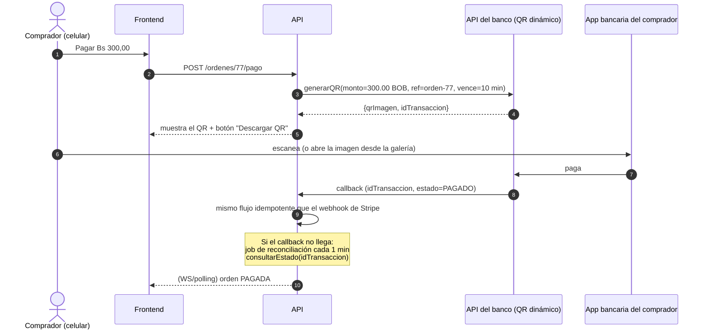

### Diferencias que hay que contemplar con el QR

1. **Experiencia en el celular:** el comprador **ya está en su celular** y no puede escanear su propia pantalla. Hay que ofrecer "Descargar QR" o "Compartir" para abrirlo desde la galería en la app bancaria. Este detalle práctico es muy boliviano y a menudo se olvida.
2. **Tiempo de reserva:** abrir la app bancaria y pagar tarda más que con tarjeta. Conviene que el TTL de la reserva sea **configurable por proveedor** (p. ej. 5 min para tarjeta y 10 min para QR), con un vencimiento del QR **menor o igual** al de la reserva.
3. **Callbacks menos confiables:** se agrega el job de **reconciliación** (`consultarEstado` sobre los pagos EN_PROCESO de más de 1 min). Tanto el callback como la reconciliación pasan por la **misma** lógica idempotente: si llegan los dos, se procesa uno.
4. **Reembolsos:** el QR normalmente **no tiene reembolso automático**. REEMBOLSO_REQUERIDO implica una transferencia manual. Hay que documentarlo en los términos de venta.
5. **Facturación:** la orden pagada dispararía (vía outbox) un job de facturación electrónica del SIN. **Fuera de alcance**, pero el punto de extensión ya existe.

## 5. Qué demostramos en el proyecto vs. qué sería producción

| Aspecto | Proyecto (demo) | Producción en Bolivia |
|---|---|---|
| Proveedor | Stripe **test** + Simulador | QR dinámico bancario (+ PagosNet para tarjetas) |
| Dinero real | ❌ Nunca | ✅ |
| Confirmación asíncrona por webhook | ✅ | ✅ (callback del banco) |
| Firma del webhook | ✅ Stripe-Signature / HMAC | Según el banco |
| Idempotencia ante duplicados | ✅ Demostrada con el simulador | ✅ Misma lógica |
| Pagos tardíos y desordenados | ✅ Simulador | ✅ Misma lógica |
| Reconciliación | Diseñada (`consultarEstado`) | ✅ Imprescindible |
| Reembolsos | Estado REEMBOLSO_REQUERIDO (manual) | Manual o según el banco |
| Requisitos legales | — | Empresa con NIT, convenio bancario, facturación SIN |

**Mensaje para la defensa:** "La parte difícil de un sistema de pagos, que es la confirmación asíncrona, idempotente y tolerante a duplicados y retrasos, **es la misma** con cualquier proveedor. La demostramos con Stripe test y con un simulador que inyecta fallos. Cambiar a un QR bancario boliviano es **escribir un adaptador**, no rediseñar."

## 6. Fuentes

Oficiales:
- Stripe, países: <https://stripe.com/global>
- dLocal, "Pago al Paso" (Bolivia): <https://dlocal.com/payment-method/pago-al-paso-payment>
- BCB, notas de prensa sobre el sistema de pagos: <https://www.bcb.gob.bo/webdocs/10_notas_prensa/CP-48%20Informe%20BID%20sistema%20de%20pagos_okok.pdf>
- ASFI, "El uso del QR ha dinamizado el sistema de pagos en Bolivia": <https://asfi.gob.bo/sites/default/files/2025-07/El%20uso%20del%20QR%20ha%20dinamizado%20el%20sistema%20de%20pagos%20en%20Bolivia.pdf>
- FLAR, Sistemas de Pagos Inmediatos en ALC (2025): <https://flar.com/wp-content/uploads/2025/11/FLAR_Consideraciones-para-el-Desarrollo-de-SPI-en-America-Latina-y-el-Caribe_2025.pdf>

Prensa y secundarias:
- Los Tiempos, "El BCB resalta uso del QR 28 veces por segundo" (jun. 2026): <https://www.lostiempos.com/actualidad/economia/20260614/banco-central-bolivia-resalta-uso-del-qr-28-veces-segundo-pais>
- Los Tiempos, "En 2025 se duplicó el uso del QR": <https://www.lostiempos.com/actualidad/economia/20260504/2025-se-duplico-uso-del-qr-paso-us-22547-millones-51293-millones>
- eju.tv, "Pagos por QR crecen y en 2025 movieron más de Bs 357.747 millones": <https://eju.tv/?p=4977164>
- Bemorex, "Pagos digitales QR en Bolivia": <https://bemorex.com/blog/pagos-digitales-qr-bolivia-integrar-negocio>
- Bemorex, "E-commerce en Bolivia: pasarelas de pago locales": <https://bemorex.com/blog/ecommerce-en-bolivia-vender-online-pasarelas/>
- Comparasoftware Bolivia, pasarelas de pago: <https://www.comparasoftware.com.bo/pasarelas-de-pagos>
- Tigo Money (prensa): <https://eju.tv/?p=2391176> · <https://eju.tv/?p=3473550>
- Página de estado de dLocal (incidente que afectó a procesadores de Bolivia): <https://pingoru.io/providers/dlocal/incidents/1462438>

**No verificado (pendiente de contacto directo):** documentación de la API de QR dinámico de cada banco, OpenBCB, Libélula, Circle.bo, API de Tigo Money y Yape para comercios, y comisiones vigentes de PagosNet.


